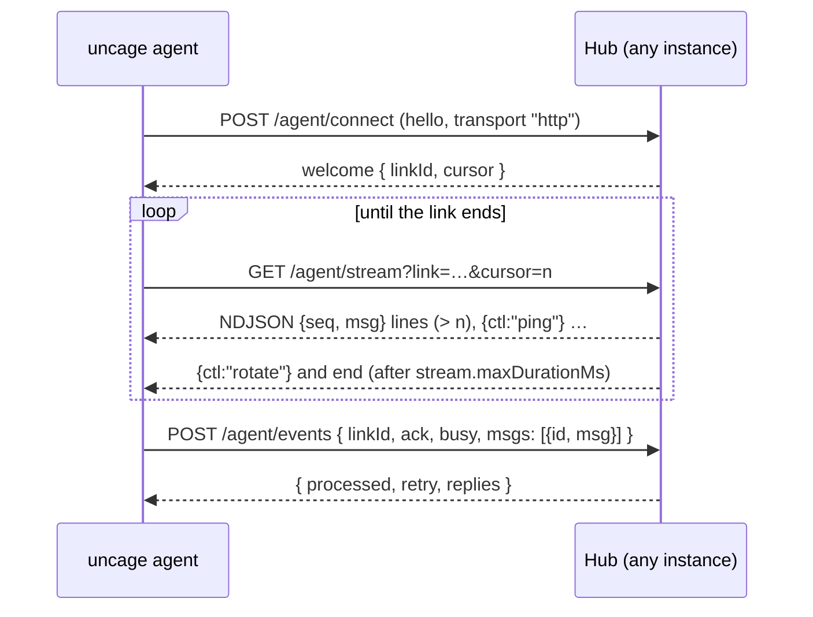

これらを自分で呼び出すことはほとんどありません。呼び出すのは`@uncage/client`（とその上に作られたReactパッケージ）です。ここでは、独自のクライアント、デバッグ、コーディングエージェント向けに一覧を示します。すべてのボディの型は`@uncage/protocol`にあります。

## 2つのサーバー、1つのAPIの形

| | Connected モードのハブ | Local モードのデーモン |
| --- | --- | --- |
| ベース | `<publicUrl><basePath>`（デフォルトは`/api/uncage`） | `http://127.0.0.1:4783/v1`。`/api/uncage`のプロキシ経由でアクセスします |
| 認証 | `getUser(req)`を介したサイトのCookie | `Authorization: Bearer <token>`。プロキシが付与します |
| 追加分 | `/machines`、デバイスエンドポイント、`install.sh` / `install.ps1`、`/maintenance`、エージェントのトランスポート | なし |

セッション、実行、イベント、承認のルートは、どちらでもリクエストとレスポンスの形が同じです。そのため、同じクライアントがどちらに対しても動作します。`/api/uncage`を指定すれば、ハブともプロキシともやり取りできます。

## ブラウザAPI

以下のルートはすべて、サインイン中のユーザーが必要です（いなければ`401 unauthorized`）。他のユーザーのリソースは、存在しない場合と同じく`404`を返します。別のオリジンからのGET以外のリクエストは`403 forbidden_origin`になります。

| メソッドとパス | ボディ / クエリ | 応答 |
| --- | --- | --- |
| `GET /health` | | `{ ok: true, protocol: "1.0", version }` |
| `GET /runtimes` | `?machineId=`（任意） | そのコンピュータの`RuntimeInfo[]`。指定がなければ、最初のオンラインのコンピュータのもの |
| `GET /machines` | | `MachineInfo[]`：`{ id, name, os, agentVersion, runtimes, online, lastSeenAt, agentOutdated, transport }`。最後に確認された時刻が新しい順。`agentOutdated`：エージェントが`minAgentVersion`より古い（「Agent update needed」を表示します）。`transport`：`'ws'`、`'http'`、オフラインの間は`null` |
| `GET /machines/install` | | `{ install, setup, windows }`：表示するコマンド（`curl … install.sh \| bash`、`uncage setup <url>`、`irm … install.ps1 \| iex`） |
| `DELETE /machines/:id` | | `{ ok: true }`。コンピュータを取り消します |
| `GET /sessions` | | `Session[]`。それぞれに`machineId`が付き、古い順 |
| `POST /sessions` | `{ runtime, title?, machineId? }` | `201 Session`。`machineId`がない場合は、最後に確認されたオンラインのコンピュータ。`workspace`は無視されます |
| `GET /sessions/:id` | | `SessionSnapshot`：`{ session, runs, pendingApprovals, lastSequence }` |
| `PATCH /sessions/:id/settings` | `{ model?, effort?, permissionMode? }`（1つ以上） | `Session` |
| `POST /sessions/:id/runs` | `{ prompt, attachmentIds? }` +ヘッダー`Idempotency-Key` | `202 Run` |
| `GET /sessions/:id/events` | `?after=<sequence>`またはヘッダー`Last-Event-ID` | `UncageEvent`のSSEストリーム。`Accept: application/json`を付けるとJSON配列（`?limit=`） |
| `POST /sessions/:id/attachments` | 生のバイト列。ヘッダー`Content-Type`、`X-Filename`（URIエンコード） | `Attachment`。最大10MiB（Vercelでは、約4.5MBを超えるボディはプラットフォームが先に拒否します） |
| `GET /attachments/:id` | | ファイル |
| `GET /runs?active=1` | | `ActiveRunInfo[]`：ユーザーのセッションで進行中の実行 |
| `GET /runs/:id` | | `Run` |
| `POST /runs/:id/cancel` | | `202` |
| `GET /approvals?sessionId=` | | そのセッションの保留中の`ApprovalRequest[]` |
| `POST /approvals/:id/decision` | `{ decision: "allow" \| "deny", scope: "once" \| "session", reason? }` +ヘッダー`Idempotency-Key` | 更新された`ApprovalRequest`。2回目に異なる判定を送ると`409` |

Local モードのデーモンには、`/machines*`を除く同じルートが`/v1`配下にあり、`POST /v1/sessions`では`workspace`（許可されたルートの内側）を受け付けます。

### Server-Sent Events

`GET /sessions/:id/events`は`text/event-stream`をストリーミングします。各イベントはSSEの`id`としてシーケンス番号を持つため、再接続した`EventSource`（または`@uncage/client`）は`Last-Event-ID`で再開します。プロキシがストリームを閉じないよう、15秒ごと（`sseHeartbeatMs`）にコメント行が送られます。`stream.maxDurationMs`（デフォルトは250秒）が経過すると、ハブは`data: {}`付きの`event: reconnect`を送ってストリームを終了します。`Last-Event-ID`を付けてすぐに再接続すれば（`@uncage/client`はそうします）、続きのイベントを欠落も重複もなく受け取れます。届くイベントは次のとおりです：`session.created`、`session.updated`、`run.started`、`run.updated`、`run.completed`、`run.failed`、`run.cancelled`、`run.interrupted`、`message.started`、`message.delta`、`message.completed`、`tool.started`、`tool.updated`、`tool.completed`、`tool.failed`、`approval.requested`、`approval.updated`、`approval.resolved`、`system.warning`。

## マシン側（公開）

CLIとエージェントが使います。これらは`getUser`を呼びません。

| メソッドとパス | |
| --- | --- |
| `GET /install.sh` | macOS / Linux用のインストーラー（`text/plain`）。内容は固定で、変わるのはCLIのバージョン範囲、サイトのURL、`installScript`のテキストだけです |
| `GET /install.ps1` | Windows PowerShell用の同じインストーラー |
| `POST /device/code` | デバイスログインを開始します。ユーザーコード、検証用リンク、ポーリング間隔（2秒）、有効期限（600秒）を返します。クライアントIPごとにレート制限があります |
| `POST /device/token` | `{ deviceCode }`：ユーザーが承認するまでポーリングし、承認後にマシントークンを1回だけ、提供されるトランスポートとともに返します |
| `POST /machine/revoke` | `Authorization: Bearer <machine token>`：コンピュータが自身を取り消します（`uncage sites remove`） |
| `GET /agent/info` | `{ protocol, minAgentVersion, transports: [{ kind, url }] }`：エージェントが使うべきもの。`kind`は`ws`（`attachWebSocket`が実行されている場合か、`transports`に含まれている場合のみ）または`http` |
| `GET /agent`（WebSocketのアップグレード） | WebSocketのトランスポート（`Authorization: Bearer <machine token>`）。`attachWebSocket(hub, server)`が処理します。フレームはJSONで、各1MiBまでです。WebSocketサーバーが動いていない環境（FaaS モード）では、アップグレードのリクエストに`426 upgrade_required`が返ります |
| `/agent/connect`、`/agent/stream`、`/agent/events`、`/agent/disconnect` | HTTPストリーミングのトランスポート（後述） |
| `GET\|POST /maintenance` | `maintenance.secret`を設定した場合のみ：`Authorization: Bearer <secret>`を付けると、その場でメンテナンスを実行し、`{ ran, pruned, interruptedToolCalls }`を返します（`maintenance.intervalMs`以内に別のインスタンスが実行済みなら`ran: false`）。シークレットがなければ`404` |

## エージェントのトランスポート（HTTPストリーミング）

ハブが`http`しか提供していない場合（FaaS モード）や、WebSocketの失敗が続く場合に、エージェントはこれを使います。すべてのリクエストには`Authorization: Bearer <machine token>`が付きます。トークンがない、または誤っている場合は`401`が返り、同じIPからそれが多すぎると`429`になります（`rateLimits.agentAuthFailuresPerMinute`）。状態はストアにあるため、これらのリクエストはどのハブのインスタンスでも処理できます。型は`@uncage/protocol`にあります（`HttpConnectResponse`、`StreamLine`、`HttpEventsRequest`、`HttpEventsResponse`）。



### `POST /agent/connect`

ボディ：エージェントの`hello`フレーム、`{ "t": "hello", "protocol": 2, "agentVersion": "0.3.0", "transport": "http", "machine": { "name", "os", "runtimes" } }`。応答：

- `200 { "t": "welcome", machineId, protocol, minAgentVersion, linkId, cursor, replies }`。`linkId`（`lnk_` + 16進数24文字）はこの接続の名前で、`cursor`は受領確認済みのアウトボックスの最大のシーケンス番号です。新しいconnectが来ると、以前のリンクは置き換えられます。
- `426 { "t": "upgrade_required", minAgentVersion }`：エージェントが古すぎます（古いプロトコル、または`minAgentVersion`未満）。ハブはウェブサイト向けに、そのコンピュータを「古い」と記録します。

### `GET /agent/stream?link=<linkId>&cursor=<n>`

`application/x-ndjson`で、1行に1つのJSONオブジェクトです。

| 行 | 意味 |
| --- | --- |
| `{"seq":12,"msg":{…}}` | アウトボックスの項目：シーケンス番号付きのハブのフレーム（`command`、`tool_result`、`ack`など）。シーケンス番号は常に`cursor`より大きくなります。処理してから`seq`を記憶します。 |
| `{"ctl":"ping","at":…}` | ハートビート。`heartbeat.pingIntervalMs`（10秒）ごとに送られます。 |
| `{"ctl":"rotate"}` | ハブがこのストリームを終了します（`stream.maxDurationMs`の経過後、またはシャットダウン中）。同じリンクと自分のカーソルを付けて、すぐに再接続します。 |
| `{"ctl":"replaced"}` | 新しい`connect`がこのリンクを引き継ぎました。停止します。 |
| `{"ctl":"closed"}` | リンクは閉じられましたが、コンピュータはまだ存在します。もう一度`connect`します。 |
| `{"ctl":"revoked"}` | コンピュータが取り消されました。停止します。 |

ストリームを開くと、`cursor`を**受領確認した**ことになります。ハブはそこまでのアウトボックスの項目を削除し、それより後の項目をストリーミングします。同じカーソルで開き直すと未処理の項目が再配信されるため、ストリームが切れても項目が失われることはありません。知らない制御行は読み飛ばしてください。ストリームがアイドルの間、ハブはアウトボックスをポーリングします。コンピュータが処理中か、直近の`polling.activeWindowMs`（30秒）以内に何かが配信された場合は`polling.activeMs`（300ms）ごと、それ以外は`polling.idleMs`（2秒）まで間隔を広げます。別のインスタンスで書き込まれたコマンドは、クラスターを通じてストリームを起こします。

### `POST /agent/events`

```json
{ "linkId": "lnk_…", "ack": 12, "busy": true, "msgs": [{ "id": "up_3f9c…", "msg": { "t": "events", "sessionId": "…", "events": [] } }] }
```

- `msgs`：上り方向のフレーム（`hello`と`pong`を除く、エージェントが送るすべてのもの）。それぞれに冪等なID（`up_` + 16〜64文字）が付きます。1リクエストあたり最大500メッセージ、**リクエストボディは1MiBまで**（`MAX_HTTP_BODY_BYTES`）です。それより大きいファイルは複数のチャンクに分けて送られます。
- `ack`：処理済みのアウトボックスの最大のシーケンス番号。これにより、ハブは次のストリームを待たずに配信済みの項目を削除できます。
- `busy`：コンピュータ上で処理が進行中であること（ストリームを高速ポーリングのモードに保ちます）。

応答：`{ "processed": [ids], "retry": [ids], "replies": [frames] }`。`processed`は、今回または以前に処理されたIDの一覧です（重複は24時間認識され、再適用されません）。これらは破棄してください。`retry`は、ハブがまだ受け付けられなかったIDの一覧です（たとえば別のインスタンスでまだ実行中のツール呼び出し）。後のリクエストで、順番どおりに再送してください。メッセージは厳密に順番どおりに適用され、待つ必要のある最初のメッセージで処理が止まります。

サイトツールの呼び出し（`tool_call`）は、このリクエストの中でハンドラーを実行し、その結果は`replies`で（または後でストリームで）返ります。同じIDで再試行された呼び出しは、再実行されずに保存済みの結果を返します。

このルート固有のエラー：`details.reason: 'link_replaced'`付きの`400 invalid_request`（停止します。新しい接続が存在します）、または`'link_closed'`付き（もう一度connectします）。

### `POST /agent/disconnect`

`{ "linkId": "lnk_…" }`：リンクを閉じ、コンピュータがすぐにオフラインと表示されるようにします。`204`を返します。

## エラー

すべてのエラーは、そのコードに対応するHTTPステータスを持つJSONです。

```json
{ "code": "machine_offline", "message": "The machine is offline.", "hint": "Make sure the Uncage agent is running on that machine and connected to the internet.", "retryable": true, "requestId": "req_…" }
```

必要に応じて`details`が追加されます（例：`details.reason`、`details.retryAfterSec`）。全一覧は[エラーコード](/docs/ja/reference/errors/)にあります。
