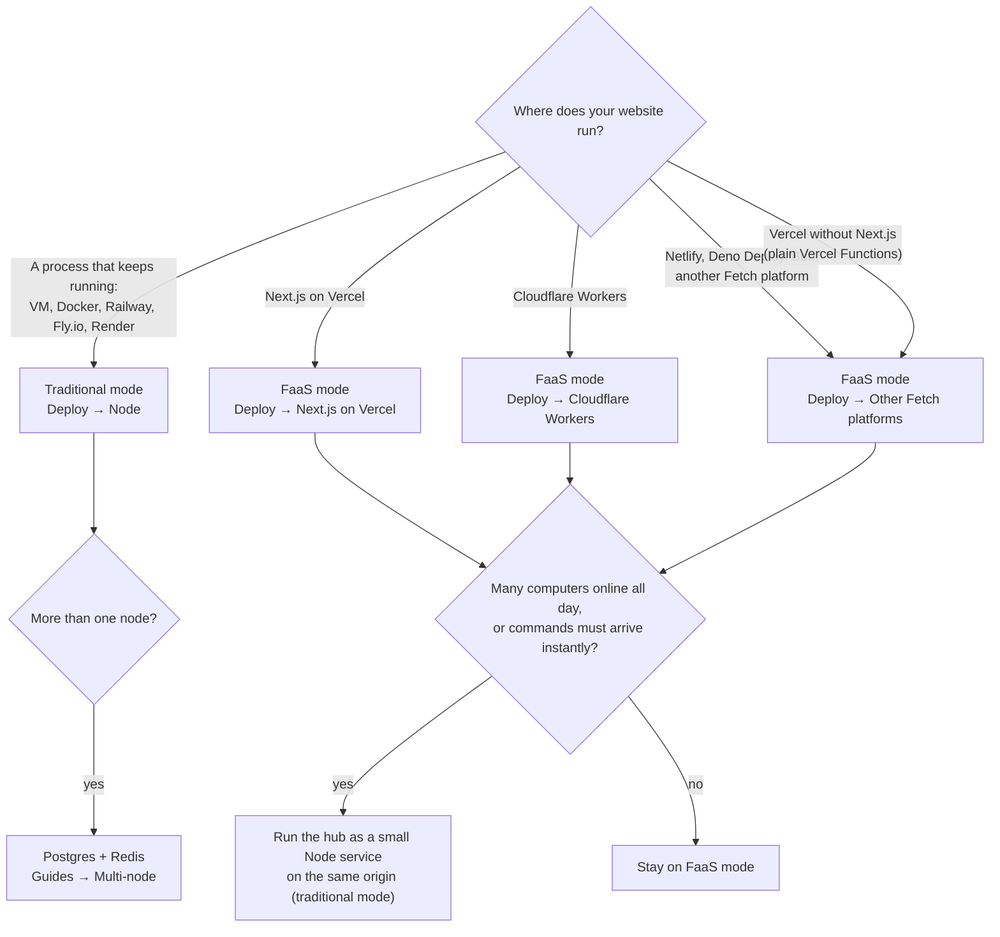

ハブ（`@uncage/hub`）は、ウェブサイトが動いている場所で動きます。デプロイの方法は2つあります。どちらもハブ本体、`createHub`のオプション、サイトツール、スキル、UIは同じです。違うのは3点だけです。ハブが状態をどこに保存するか、ユーザーのコンピュータがどう接続するか、ハブをどうマウントするかです。

- **従来モード（常駐プロセス）**：ウェブサイトが常駐するNodeプロセスとして動いている場合です（VM、コンテナ、Railway、Fly.io、Render、自前のサーバー）。ハブは組み込みデータベースのフォルダにデータを保存し、接続中のすべてのコンピュータとWebSocketを維持します。追加でインストールするものはありません。
- **FaaS モード**：ウェブサイトがサーバーレス関数やFetch対応プラットフォーム（VercelのNext.js、Cloudflare Workers、Netlify、Deno Deployなど）で動いている場合です。関数インスタンスは起動と終了を繰り返すため、ハブはすべてをPostgresに保存し、コンピュータは**HTTPストリーミング**で接続します。これは長時間のリクエストで、ハブがプラットフォームの制限時間より前に終了させ、エージェントがすぐに開き直します。

どちらのモードを使っているかを、ユーザーのコンピュータに伝える必要はありません。エージェントはハブが提供するトランスポートを問い合わせ（`GET <basePath>/agent/info`）、自分で選択します。

## 比較

| | 従来モード | FaaS モード |
| --- | --- | --- |
| **サイトが動く場所** | 常駐するNode.js 22以降のプロセス | サーバーレス関数またはFetch対応プラットフォーム |
| **依存関係** | なし：`pgliteHubStore`（フォルダ内の組み込みPostgres）とインメモリのクラスター。複数ノードの場合はPostgres + Redis | Postgres（`DATABASE_URL`）。Redisは任意 |
| **コンピュータの接続方法** | WebSocket（フォールバックとしてHTTPストリーミングも提供） | HTTPストリーミング（`/agent/stream` + `/agent/events`） |
| **コンピュータにコマンドが届くまでの遅延** | 即時（ソケット経由でプッシュ） | Runの実行中は約300ms。30秒間何もなければ最大約2秒 |
| **コストの構造** | コンピュータの台数にかかわらず、常時稼働のプロセス1つ | オンラインのコンピュータ1台につき、**継続する関数呼び出しがおよそ1つ**（そのストリーム。約250秒ごとに開き直し）。加えてデータベースのポーリング（後述） |
| **インスタンス** | デフォルトは1つ。Postgres + Redisでノードを追加 | 常に複数（関数インスタンスのそれぞれがハブ）。スティッキーセッションは不要 |
| **考慮すべきプラットフォームの制限** | 前段のプロキシがWebSocketのアップグレードを通すこと | 関数の実行時間（Vercel：デフォルトで300秒）、リクエストボディのサイズ（Vercel：約4.5MB）、CPU時間（Workers） |
| **マウント方法** | `@uncage/hub/node`の`toNodeHandler(hub)` + `attachWebSocket(hub, server)` | `toNextHandlers(…)`（Next.js）、`fetchOnce(…)`（Workers）、または`hub.fetch(req)` |
| **ガイド** | [Node（従来モード）](/docs/ja/deploy/node/) | [VercelでNext.js](/docs/ja/deploy/vercel/)、[Cloudflare Workers](/docs/ja/deploy/cloudflare-workers/)、[その他のFetch対応プラットフォーム](/docs/ja/deploy/other-fetch-platforms/) |

## 選び方

判断の目安：

- **すでにNodeサーバーを運用している**：従来モードを選びます。最もシンプルかつ高速で、新たに用意するものもありません。
- **サイトがVercel、Workers、その他のサーバーレスプラットフォームにある**：FaaS モードを選びます。Postgresデータベースを追加すれば完了で、別のサービスを運用する必要はありません。
- **まだ決めかねている**：現在のサイトに合うほうから始めてください。後から切り替えても、変わるのはストア、クラスター、マウント部分の数行だけです（[後から切り替える](#後から切り替える)を参照）。

## FaaS モードのコスト

FaaSプラットフォームは、形はさまざまですが、関数が動いている時間に対して課金します。Vercel（Fluid compute）は、アクティブなCPU時間に加え、インスタンスが動いている間に確保されたメモリに対して課金します。そのため、ほとんど待機しているだけのストリームはメモリ時間を消費しますが、CPUはほとんど使いません。Cloudflare WorkersはCPU時間だけに課金します。FaaS モードでは次のようになります。

- **オンラインのコンピュータは、それぞれ1つのリクエストを開いたままにします**。これがHTTPストリームです。ハブは`stream.maxDurationMs`（デフォルトは250秒で、Vercelの300秒の制限より短い値）が経過するとストリームを終了させ、エージェントはすぐに開き直します。つまり、1日中オンラインのコンピュータは、作業をしているかどうかにかかわらず、1日中関数インスタンスを占有します（Vercelでは、複数のストリームが1つのインスタンスを共有できます）。Cloudflare Workersでは、I/Oの待ち時間はCPU時間に含まれません。
- **開いている各ストリームは、そのコンピュータのアウトボックスをPostgresでポーリングします**。直近30秒以内に何かが起きた場合やRunの実行中は300msごと、アイドル時は2秒ごとに間隔を広げます（`polling: { activeMs, idleMs, activeWindowMs }`）。Postgres 16での実測値は、アイドル状態のコンピュータ1台あたり**毎秒約0.5クエリ**、Runの実行中は**毎秒2.3クエリ**です。
- **`postgresCluster`もポーリングします**（インスタンスごとに、処理中は300msごと、静かなときは2秒ごと）。インスタンス間でウェイクアップを受け渡すためです。
- **コンピュータがオンラインの間、データベースはスリープしません**。ゼロまでスケールするPostgres（Neonの無料プランなど）も、ストリームやインスタンスがポーリングしている限り起動したままになります。

デモや少人数での利用なら問題ありません。リファレンスのデモは、数台のコンピュータがオンラインの状態でVercel Hobbyで動くよう設計されています。多数のコンピュータが何時間もオンラインのままだと、コストが積み上がります。

### 従来モードへの切り替えやRedisの追加を検討すべきとき

- **多数のコンピュータが1日中オンライン**（数十台以上）：関数の稼働時間は、オンラインのコンピュータが増えるたびに伸びていきます。単一のNodeプロセス（従来モード）なら、小さなサーバー1台分のコストで、アイドル状態のWebSocketを数千本維持できます。
- **コマンドを即座に届ける必要がある**（300msから2秒の遅れが目立つ対話的なツール）：従来モードはWebSocketでプッシュします。
- **ポーリングによるデータベース負荷**：Redis（`cluster: redisCluster({ url })`）を追加します。インスタンス間のウェイクアップが、ポーリングされるテーブルではなくRedisのpub/subで伝わるため、クラスターのポーリングがなくなり、アイドル状態のコンピュータのストリームにもコマンドがすぐに届きます。開いている各ストリームのアウトボックスのポーリングは残ります。
- **時間のかかるサイトツールのハンドラー**（数分単位）：FaaSの関数には制限時間があり、ツール呼び出しはすべて1つのリクエストの中で実行されます。ハンドラーに必要なだけ時間をかけられる場所でハブを動かすか、時間のかかる処理をバックグラウンドジョブに移してIDを返すようにしてください。

サイトはVercelに置いたまま、ハブだけを**同一オリジン**の小さなNodeサービスとして動かすこともできます（エッジで`/api/uncage/*`をそのサービスにルーティングします）。[Node → FAQ](/docs/ja/deploy/node/#faq)を参照してください。

## 両モードで共通のこと

- `createHub`のオプション、`defineTool`、スキル、`selectManifest`、`sessionStorage`、`getUser`、`<AgentChat>`、`/device`の承認ページ。
- **保証**。接続が切れても、ツール呼び出しは**ちょうど1回**実行されます（呼び出しとその結果は保存され、IDは冪等で、エージェントが再送します）（FaaSプラットフォームでは、ハブにプラットフォームの`waitUntil`を渡した場合。[Workers → FAQ](/docs/ja/deploy/cloudflare-workers/#workersでサイトツールはちょうど1回実行されますか)を参照）。ハンドラーを実行中のインスタンスが呼び出しの途中で停止した場合（クラッシュ、デプロイ、プラットフォームの制限時間）、呼び出しは**最大1回**の実行になります。「Site tool "<name>" timed out on the website. Please try again.」というエラーで失敗し、自動的に再実行されることはありません。イベント、承認、ファイルの取得は、接続の切断、ストリームの開き直し、再試行をまたいでも、失われることも重複することもありません。詳しくは[ツールを定義する → 接続が切れたとき、インスタンスが停止したとき](/docs/ja/guides/define-tools/#接続が切れたときインスタンスが停止したとき)を参照してください。
- **セキュリティ**。レート制限と、コードの入力失敗のカウンターはハブのストアに保存されるため、すべてのノードとすべての関数インスタンスで1つのカウントを共有します。

## 後から切り替える

ツール、スキル、サインイン、ページは変わりません。変わるのは次の点です。

| 切り替え | 変更点 |
| --- | --- |
| 従来モード → FaaS モード | `store`を`pgliteHubStore`から`postgresHubStore`に変えます。`cluster: postgresCluster(…)`（またはRedis）を追加します。`toNodeHandler` + `attachWebSocket`ではなく、`toNextHandlers` / `fetchOnce` / `hub.fetch`でマウントします。`stream.maxDurationMs`をプラットフォームの制限より短く設定します。 |
| FaaS モード → 従来モード | Nodeサーバーで`toNodeHandler` + `attachWebSocket`を使ってマウントします。`postgresHubStore`はそのまま使えます（データの移行は不要）。単一ノードなら`pgliteHubStore`に切り替えてもかまいません。 |

データベースが同じであれば、接続済みのコンピュータは自動的に切り替えに追従します。エージェントが提供されるトランスポートを読み直すためです。**データベースを新しくすると、ペアリングもやり直しになります**。古いストアでペアリングしたコンピュータは新しいストアには登録されていないため、`uncage setup <url>`を再度実行する必要があります。
