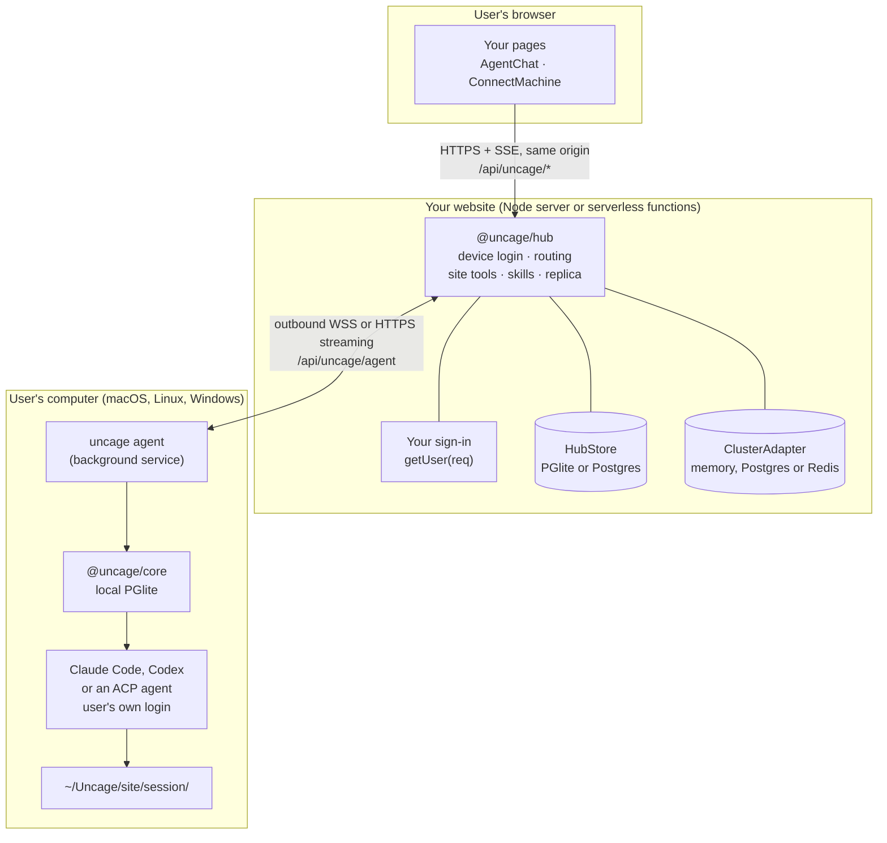
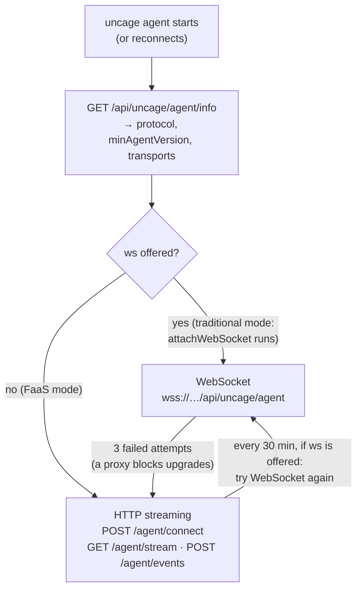

Connected モードでは、コードが動く場所が3つあります。そのうち、あなたがデプロイするのは1つだけです。



- **ブラウザ**は、ユーザーの通常のセッションCookieを使って、あなたのウェブサイトの`/api/uncage/*`とだけ通信します。`@uncage/react-ui`の`<AgentChat>`がこれを代わりに行います。
- **あなたのウェブサイト**は、ハブ（`@uncage/hub`）をマウントします。マウント先は、常駐するNodeプロセス（従来モード）か、サーバーレス関数（FaaS モード。[デプロイモードを選ぶ](/docs/ja/start/choose-deployment-mode/)を参照）です。ハブはデバイスログインを処理し、接続中のすべてのコンピュータに到達できる状態を保ち、ブラウザからのリクエストを正しいコンピュータへルーティングし、サイトツールを実行し、（任意で）すべての会話のコピーを保持します。
- **ユーザーのコンピュータ**では`uncage agent`が動きます。これは`uncage setup`がインストールする、ユーザー単位のバックグラウンドサービスです。エージェントはハブへ**外向きに**接続する（WebSocketまたはHTTPSストリーミング。[後述](#コンピュータの接続方法)）ため、ユーザー側にパブリックIP、ポートフォワーディング、トンネルは不要です。エージェントはLocal モードと同じエンジンである`@uncage/core`を通じて、ユーザーのコーディングエージェントをセッションごとに新しいフォルダで実行します。使えるのはClaude Code、Codex、または[Agent Client Protocol](/docs/ja/guides/use-any-acp-agent/)を話すあらゆるエージェント（Gemini CLI、OpenCodeなど）です。コンピュータにインストールされているACP エージェントはACPレジストリをもとに自動的に検出され、プロトコルのハンドシェイクに応答した後にだけ有効になります。ダウンロードが必要なもの（`npx`、`uvx`）は、ユーザーが`uncage runtimes enable <id>`で同意するまで実行されません。

セッションの正となるデータはユーザーのコンピュータ（そのローカルのPGliteデータベース）にあります。ハブはセッションのインデックスを保存し、`sessionStorage: 'site'`を指定した場合はイベントの追記専用レプリカも保存します。

## コンピュータの接続方法

ハブは1つか2つの**トランスポート**を提供し、エージェントがそのうち1つを自動的に選びます。開発者が選ぶのは、ハブをどこで動かすかだけです。



- **WebSocket**（従来モード）：1本の接続ですべてを双方向にやり取りします。ハブはコマンドを即座にプッシュし、10秒ごとにpingを送ります。
- **HTTPストリーミング**（FaaS モード、および従来モードでのフォールバック）：下り方向では、エージェントが`GET <basePath>/agent/stream?cursor=<n>`を開いたままにします。ハブはそのコンピュータへのコマンドを、ストア内の永続的な**アウトボックス**にシーケンス番号付きで書き込み、NDJSONの行としてストリーミングします。プラットフォームの制限時間（`stream.maxDurationMs`、デフォルトは250秒）が来る前に、ハブは`rotate`の行でストリームを終了させ、エージェントは最後に処理した行のカーソルを付けてすぐに開き直します。上り方向では、エージェントがイベント、ツール呼び出し、ファイルのチャンクを`POST <basePath>/agent/events`で最大1MBずつまとめて送ります。各メッセージには冪等なIDが付いているため、POSTを再試行しても二重に適用されることはありません。ストリームはRunの実行中は300msごとにアウトボックスをポーリングし、アイドル時は2秒ごとに間隔を広げます。メモリ上に状態を持たないため、どの関数インスタンスでもどのリクエストを処理できます。

どちらの場合も、接続が生きている間（WebSocketがpingに応答しているか、ストリームが開いている間）、コンピュータは**オンライン**です。通信が途絶えてから約30秒でオフラインになります。ルートとフレームについては、[HTTP API → エージェントのトランスポート](/docs/ja/reference/http-api/#エージェントのトランスポートhttpストリーミング)を参照してください。

## ステップごとの流れ


### 1. 接続する

1. ページにコマンドを表示します。`<ConnectMachine>`がハブ（`GET /api/uncage/machines/install`）から取得して描画します：

   ```sh
   curl -fsSL https://your.site/api/uncage/install.sh | bash
   uncage setup https://your.site
   ```

   Windowsでのインストールコマンドは`irm https://your.site/api/uncage/install.ps1 | iex`です。

2. `install.sh`（macOS、Linux）と`install.ps1`（Windows）は、ハブが配信する固定のスクリプトです。コンピュータの状態（OS、Node.js 22以降、npm、インストール済みのコーディングエージェント）を確認し、必要な手順ごとに`[Y/n]`で確認を求めます。Node.jsは、ユーザー自身のバージョンマネージャー（nvm、fnm、voltaなど）があればそれを使ってインストールします（`sudo`や管理者権限は一切使わず、デフォルトのNodeのバージョンも同意なしには変更しません）。グローバルのnpmフォルダに書き込めない場合はユーザー所有のnpmフォルダを用意し、最後に`@uncage/cli`をインストールします。コーディングエージェント自体はインストールせず、見つからない場合はClaude Codeのインストーラーを案内します。最後に、このウェブサイト向けに`uncage setup`を実行するかどうかを尋ねます。
3. `uncage setup`がデバイスログインを開始します。8文字のコード（有効期間10分）を取得し、`https://your.site/device?code=…`を開きます。
4. あなたのサイトにサインインしたユーザーがコードを確認し、**Approve**（承認）をクリックします。承認ページは`hub.approveDevice(code, user)`を呼び出します。これでコンピュータがそのユーザーに紐づけられます。
5. CLIは**マシントークン**（ランダムな値で、コンピュータとウェブサイトの組み合わせごとに1つ）を受け取り、`~/.uncage/agent.yaml`（モード0600）に保存し、エージェントをユーザー単位のバックグラウンドサービス（macOSではlaunchd、Linuxではsystemdのユーザーサービス、Windowsではスケジュールされたタスク）としてインストールします。このサービスは、インストール時に使ったNode.jsそのもので動きます。
6. エージェントが接続します（[WebSocketまたはHTTPストリーミング](#コンピュータの接続方法)）。ページの表示が「Waiting for your computer…」（コンピュータを待機中）から「Connected」（接続済み）に切り替わります。

### 2. タスクを送る

1. ユーザーが`<AgentChat>`に入力します。ブラウザはハブのブラウザ向けAPI（Local モードのデーモンの`/v1` APIと同じ形式）を呼び出します。
2. ハブは実行（Run）ごとにあなたの`selectManifest({ user, prompt, sessionId, runtime })`を呼び出し、その実行で使えるツールとスキルを選びます。指定しなければ、登録済みのすべてのツールとスキルが提供されます。サイトツールに対応していないランタイム（Codex）にはスキルだけが渡され、セッションに`site_tools_unsupported`の警告が表示されます（Codexのランタイムはスキルを受け取りますが、まだ使いません）。
3. ハブはプロンプトと**マニフェスト**（ツールの名前・説明・JSON Schema、およびスキルのテキスト）を付けて`startRun`をコンピュータに送ります。コードは含まれません。
4. エージェントは`~/Uncage/<site host>/<session id>/`でセッションのランタイムを実行します。サイトツールはClaude Codeから`mcp__site__<name>`として見えます。スキルはそのフォルダ内の`.claude/skills/<name>/SKILL.md`に書き込まれます（ACP エージェントには、最初のプロンプトにテキストとして渡されます）。
5. すべてのイベント（テキスト、ツールステップ、承認、実行状態）には番号が振られ、まずローカルに保存されてから、ハブへ、さらにSSEでブラウザへ送られます。

### 3. Claude Codeがあなたのツールを呼び出す

1. Claude Codeが`mcp__site__publish_asset`を呼び出します。ツールに`requiresConfirmation: true`が指定されていれば、`bypassPermissions`モードであっても、ユーザーにはまずあなたのUIに承認カードが表示されます。
2. エージェントがハブに`tool_call`を送ります。それを受け取ったハブのインスタンス（WebSocketを保持しているノード、またはPOSTを受け取った関数インスタンス）が、セッションがこのコンピュータとそのユーザーのものであること、ツールがその実行のマニフェストに含まれていることを確認したうえで、ハンドラーを実行します。
3. ハンドラーは`ctx.user`（セッションの所有者）、`ctx.sessionId`、`ctx.runId`、`ctx.signal`、`ctx.files`を受け取ります。`ctx.files.pull('landing')`は、セッションのワークスペース内のそのフォルダをエージェントに要求します。エージェントはワークスペース外のパスを拒否し、シンボリックリンクはたどりません。
4. ハンドラーの戻り値は、ツールの結果としてClaude Codeに返されます。すべての呼び出しとその結果は、ハブのストアに記録されます。

### 4. 成果物はあなたのサイトに残る

ハンドラーがファイルを保存したので、あなた自身のページでそれを表示できます。`sessionStorage: 'site'`を指定すると、会話もあなたのストアに複製されます。コンピュータの電源を切った状態でページをリロードしても、過程はすべて残っています。コンポーザーには、コンピュータが再接続するまでオフラインであることが表示されます。

## 障害が起きたとき

| 起きたこと | 結果 |
| --- | --- |
| 接続が切れる（ネットワーク、プロキシ、ストリームの開き直し） | 何も失われず、二重に実行されることもありません。エージェントはカーソルを付けて再接続し、まだ処理していないコマンドは再配信されます。エージェント自身のメッセージは同じIDで再送され、ハブが重複を排除します。サイトツールの呼び出しは結果とともに保存されるため、再送された呼び出しは保存済みの結果を受け取ります。つまり**ちょうど1回**です（FaaSプラットフォームでは、ハブにプラットフォームの`waitUntil`を渡した場合。[Workers → FAQ](/docs/ja/deploy/cloudflare-workers/#workersでサイトツールはちょうど1回実行されますか)を参照）。その間もRunはコンピュータ上で続行され、イベントは後から補完されます。 |
| サイトツールのハンドラーを実行中のハブのインスタンスが停止する（クラッシュ、デプロイ、プラットフォームの制限時間） | **最大1回**です。リース（`toolTimeoutMs` + 10秒）が切れた時点で、呼び出しは「Site tool "<name>" timed out on the website. Please try again.」というエラーで失敗し、自動的に再実行されることはありません。Claude Codeはエラーを見て、たいていは再試行します。保存された結果は24時間保持されます。 |
| コンピュータ上のエージェントのプロセスがクラッシュまたは再起動する | ハブが配信したものの、エージェントがまだ受領を確認していなかったコマンドは、再起動後に再配信されて実行されます。受領を確認したものの応答していなかったコマンドは、ウェブサイト側でタイムアウトします（`commandTimeoutMs`、30秒）。その場合はユーザーが再試行します。 |
| コンピュータがオフラインになる | 約30秒以内に、ウェブサイト上でオフラインと表示されます。`sessionStorage: 'site'`を指定していれば、履歴は引き続き閲覧できます。 |
| ハブの`minAgentVersion`より古いエージェントが接続する | WebSocketの場合は、アップグレードを指示され、エージェントが自分でアップグレードします。FaaS モードでは、ウェブサイトに実行すべきコマンドとともに「Agent update needed」（エージェントの更新が必要）と表示されます。 |

## データの保存場所

| 対象 | 保存場所 |
| --- | --- |
| マシントークン | ユーザーのコンピュータの`~/.uncage/agent.yaml`のみ（モード0600）。ハブはSHA-256ハッシュを保持します。 |
| セッションデータ（正） | ユーザーのコンピュータの`~/.uncage/sites/<site id>/data`（PGlite） |
| セッションのワークスペース | ユーザーのコンピュータの`~/Uncage/<site host>/<session id>/` |
| アクティビティログ | ユーザーのコンピュータの`~/.uncage/sites/<site id>/activity.log`（`uncage activity`） |
| マシン、セッションインデックス、ツール呼び出しの監査記録、アウトボックス | ハブの`HubStore`（従来モードではPGlite、複数ノードとFaaS モードではPostgres） |
| 会話のレプリカ | ハブの`HubStore`（`sessionStorage: 'site'`の場合のみ） |
| ツールが取得したファイル | ハンドラーが保存した場所 |

## 次のステップ

- [デプロイモードを選ぶ](/docs/ja/start/choose-deployment-mode/)：従来モードかFaaS モードか。
- [Connected モード クイックスタート](/docs/ja/start/quickstart-connected/)：ここまでの内容をNext.jsアプリに組み込みます。
- [コンセプト](/docs/ja/concepts/)：用語を、1つの考え方につき1セクションで説明します。
- [トラストモデル](/docs/ja/concepts/trust-model/)：ウェブサイトがユーザーのコンピュータ上でできること、できないこと。
