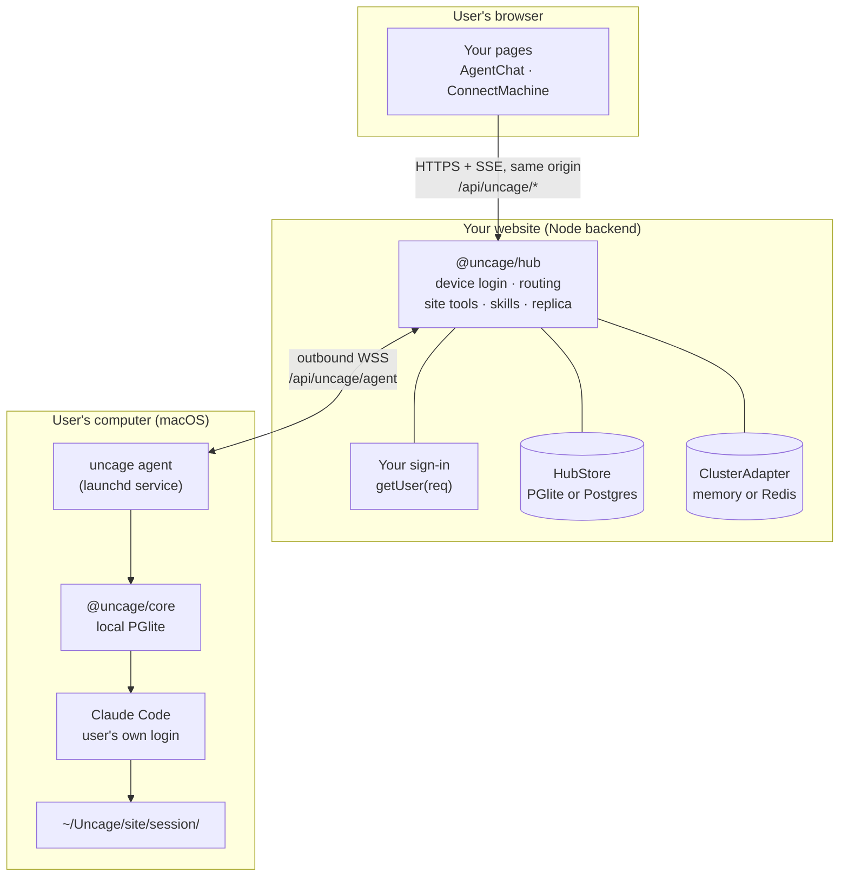
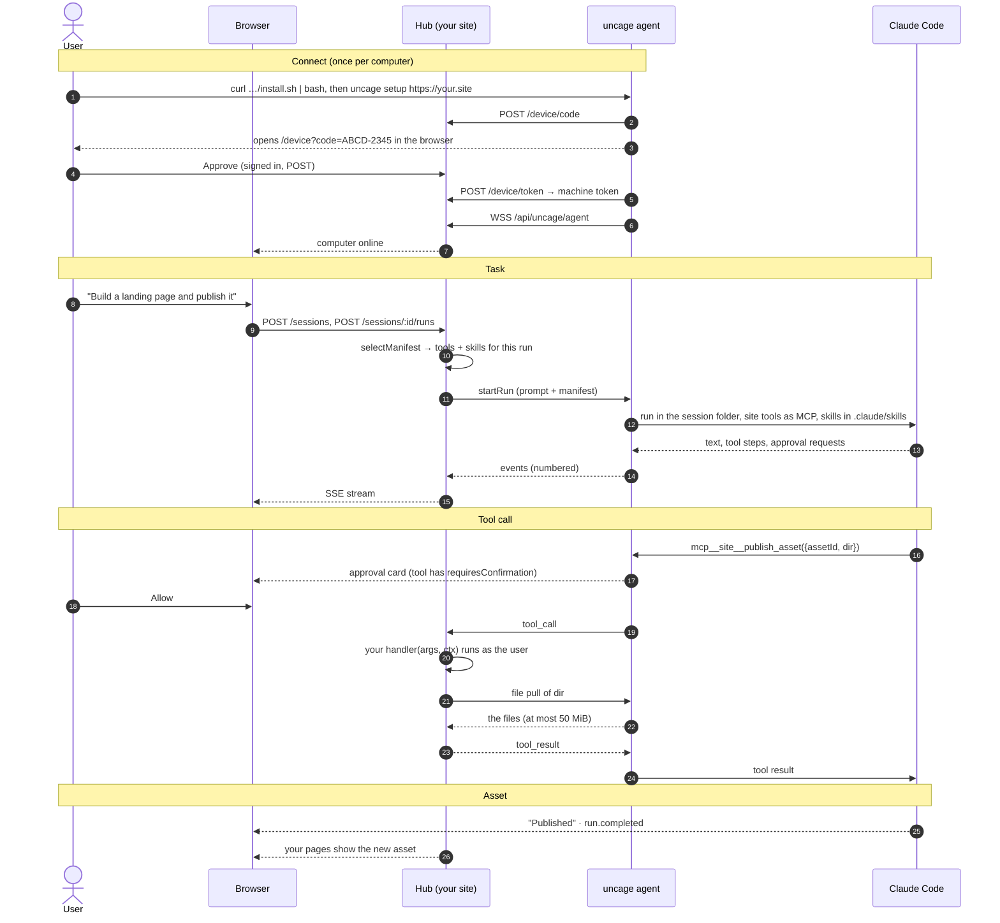

Connected モードでは、コードが動く場所が3つあります。そのうち、あなたがデプロイするのは1つだけです。



- **ブラウザ**は、ユーザーの通常のセッションCookieを使って、あなたのウェブサイトの`/api/uncage/*`とだけ通信します。`@uncage/react-ui`の`<AgentChat>`がこれを代わりに行います。
- **あなたのウェブサイト**は、Nodeバックエンドにハブ（`@uncage/hub`）をマウントします。ハブはデバイスログインを処理し、接続中のすべてのコンピュータとWebSocketを維持し、ブラウザからのリクエストを正しいコンピュータへルーティングし、サイトツールを実行し、（任意で）すべての会話のコピーを保持します。
- **ユーザーのコンピュータ**では`uncage agent`が動きます。これは`uncage setup`がインストールするバックグラウンドサービスです。エージェントはWSSでハブへ**外向きに**接続するため、ユーザー側にパブリックIP、ポートフォワーディング、トンネルは不要です。エージェントはLocal モードと同じエンジンである`@uncage/core`を通じてClaude Codeを実行し、セッションごとに新しいフォルダを使います。

セッションの正となるデータはユーザーのコンピュータ（そのローカルのPGliteデータベース）にあります。ハブはセッションのインデックスを保存し、`sessionStorage: 'site'`を指定した場合はイベントの追記専用レプリカも保存します。

## ステップごとの流れ



### 1. 接続する

1. ページに2つのコマンドを表示します。`<ConnectMachine>`がハブ（`GET /api/uncage/machines/install`）から取得して描画します：

   ```sh
   curl -fsSL https://your.site/api/uncage/install.sh | bash
   uncage setup https://your.site
   ```

2. `install.sh`はハブが配信する固定のスクリプトです。macOS、Node.js 22以降、npmを確認し、Claude Codeが見つからなければインストール方法を案内し、`@uncage/cli`をグローバルにインストールします。それ以外は何もダウンロードしません。
3. `uncage setup`がデバイスログインを開始します。8文字のコード（有効期間10分）を取得し、`https://your.site/device?code=…`を開きます。
4. あなたのサイトにサインインしたユーザーがコードを確認し、**Approve**（承認）をクリックします。承認ページは`hub.approveDevice(code, user)`を呼び出します。これでコンピュータがそのユーザーに紐づけられます。
5. CLIは**マシントークン**（ランダムな値で、コンピュータとウェブサイトの組み合わせごとに1つ）を受け取り、`~/.uncage/agent.yaml`（モード0600）に保存し、エージェントをlaunchdサービスとしてインストールします。
6. エージェントが`wss://your.site/api/uncage/agent`に接続します。ページの表示が「Waiting for your computer…」（コンピュータを待機中）から「Connected」（接続済み）に切り替わります。

### 2. タスクを送る

1. ユーザーが`<AgentChat>`に入力します。ブラウザはハブのブラウザ向けAPI（Local モードのデーモンの`/v1` APIと同じ形式）を呼び出します。
2. ハブは実行（Run）ごとにあなたの`selectManifest({ user, prompt, sessionId, runtime })`を呼び出し、その実行で使えるツールとスキルを選びます。指定しなければ、登録済みのすべてのツールとスキルが提供されます。サイトツールに対応していないランタイム（Codex）にはスキルだけが渡され、セッションに`site_tools_unsupported`の警告が表示されます。
3. ハブはプロンプトと**マニフェスト**（ツールの名前・説明・JSON Schema、およびスキルのテキスト）を付けて`startRun`をコンピュータに送ります。コードは含まれません。
4. エージェントは`~/Uncage/<site host>/<session id>/`でClaude Codeを実行します。サイトツールはClaude Codeから`mcp__site__<name>`として見えます。スキルはそのフォルダ内の`.claude/skills/<name>/SKILL.md`に書き込まれます。
5. すべてのイベント（テキスト、ツールステップ、承認、実行状態）には番号が振られ、まずローカルに保存されてから、ハブへ、さらにSSEでブラウザへ送られます。

### 3. Claude Codeがあなたのツールを呼び出す

1. Claude Codeが`mcp__site__publish_asset`を呼び出します。ツールに`requiresConfirmation: true`が指定されていれば、`bypassPermissions`モードであっても、ユーザーにはまずあなたのUIに承認カードが表示されます。
2. エージェントがハブに`tool_call`を送ります。そのコンピュータのWebSocketを保持しているノードが、セッションがこのコンピュータとそのユーザーのものであること、ツールがその実行のマニフェストに含まれていることを確認したうえで、ハンドラーを実行します。
3. ハンドラーは`ctx.user`（セッションの所有者）、`ctx.sessionId`、`ctx.runId`、`ctx.signal`、`ctx.files`を受け取ります。`ctx.files.pull('landing')`は、セッションのワークスペース内のそのフォルダをエージェントに要求します。エージェントはワークスペース外のパスを拒否し、シンボリックリンクはたどりません。
4. ハンドラーの戻り値は、ツールの結果としてClaude Codeに返されます。すべての呼び出しはハブのストアに記録されます。

### 4. 成果物はあなたのサイトに残る

ハンドラーがファイルを保存したので、あなた自身のページでそれを表示できます。`sessionStorage: 'site'`を指定すると、会話もあなたのストアに複製されます。コンピュータの電源を切った状態でページをリロードしても、過程はすべて残っています。コンポーザーには、コンピュータが再接続するまでオフラインであることが表示されます。

## データの保存場所

| 対象 | 保存場所 |
| --- | --- |
| マシントークン | ユーザーのコンピュータの`~/.uncage/agent.yaml`のみ（モード0600）。ハブはSHA-256ハッシュを保持します。 |
| セッションデータ（正） | ユーザーのコンピュータの`~/.uncage/sites/<site id>/data`（PGlite） |
| セッションのワークスペース | ユーザーのコンピュータの`~/Uncage/<site host>/<session id>/` |
| アクティビティログ | ユーザーのコンピュータの`~/.uncage/sites/<site id>/activity.log`（`uncage activity`） |
| マシン、セッションインデックス、ツール呼び出しの監査記録 | ハブの`HubStore`（デフォルトはPGlite、複数ノードではPostgres） |
| 会話のレプリカ | ハブの`HubStore`（`sessionStorage: 'site'`の場合のみ） |
| ツールが取得したファイル | ハンドラーが保存した場所 |

## 次のステップ

- [Connected モード クイックスタート](/docs/ja/start/quickstart-connected/)：ここまでの内容をNext.jsアプリに組み込みます。
- [コンセプト](/docs/ja/concepts/)：用語を、1つの考え方につき1セクションで説明します。
- [トラストモデル](/docs/ja/concepts/trust-model/)：ウェブサイトがユーザーのコンピュータ上でできること、できないこと。
