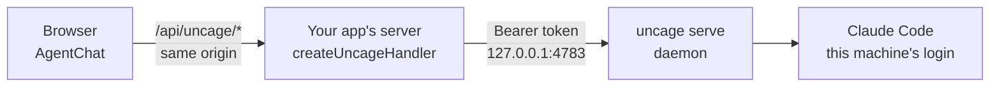

Local モードは、エージェントと**同じマシン**で動くアプリ向けです。たとえば開発者向けダッシュボード、社内ツール、デスクトップ型アプリなどです。デーモン`uncage serve`はそのマシンのClaudeログインでClaude Codeを実行します。アプリは同一オリジンのプロキシを通じてデーモンにアクセスし、デーモントークンはサーバー側で付与されます。

ユーザーがそれぞれ自分のコンピュータを持っている場合は、代わりに[Connected モード](/docs/ja/start/quickstart-connected/)を使ってください。

## コーディングエージェント用のプロンプトをコピーする

```text wrap
Add Uncage Local Mode to this Next.js (App Router) app, following https://uncage.vercel.app/docs/start/quickstart-local.md exactly.
1. npm i @uncage/server @uncage/react-ui @uncage/cli
2. Create app/api/uncage/[...path]/route.ts with createUncageHandler from @uncage/server/proxy (runtime 'nodejs', dynamic 'force-dynamic', export GET, POST, PATCH).
3. Create a page that renders <UncageProvider><AgentChat /></UncageProvider> from @uncage/react-ui inside a full-height container, and import '@uncage/react-ui/styles.css'.
Do not expose the daemon token to the browser and do not call the daemon from client code directly.
Verify: run "npx uncage doctor" and report each line; with "npx uncage serve --workspace <this repo>" running in another terminal and the app on http://localhost:3000, curl -s http://localhost:3000/api/uncage/runtimes returns a JSON array that contains "claude".
```

## 1. 前提条件

- macOS、LinuxまたはWindows、そしてNode.js **22以降**（`node -v`）。`uncage serve`はCLIが動く環境ならどこでも動きます。macOSは実機で検証済みで、LinuxとWindowsはCIで検証済み、実機での確認待ちです。
- Claude Codeがインストール済みで、サインインしていること：`npm i -g @anthropic-ai/claude-code`を実行し、`claude`を一度起動して`/login`と入力します。
- Next.js（App Router）アプリ。新規に始める場合：`npx create-next-app@latest my-app`（TypeScript、App Router）。

## 2. インストールする

```sh
npm i @uncage/server @uncage/react-ui @uncage/cli
```

## 3. 2つのファイルを追加する

ルートハンドラーは同一オリジンのプロキシです。デーモントークンをサーバー側で読み取るので、トークンがブラウザに届くことはありません。

```ts title="app/api/uncage/[...path]/route.ts"
import { createUncageHandler } from '@uncage/server/proxy';

export const runtime = 'nodejs';
export const dynamic = 'force-dynamic';
export const { GET, POST, PATCH } = createUncageHandler();
```

```tsx title="app/page.tsx"
'use client';
import { AgentChat, UncageProvider } from '@uncage/react-ui';
import '@uncage/react-ui/styles.css';

export default function Page() {
  return (
    <div style={{ height: '100vh' }}>
      <UncageProvider>
        <AgentChat locale="en" />
      </UncageProvider>
    </div>
  );
}
```

`locale`には`'en'`（デフォルト）または`'zh-CN'`を指定します。

## 4. デーモンを起動する

専用のターミナルで起動したままにしておきます：

```sh
npx uncage serve --workspace /absolute/path/to/the/project/the/agent/works/in
```

`--workspace`は、エージェントが読み取り・編集するフォルダです。初回起動時、デーモンは`~/.uncage/token`（モード600）と`~/.uncage/data`を作成し、次のように出力します：

```text
Uncage listening on http://127.0.0.1:4783 · workspace /…/project · runtimes: claude ✓, codex ✗ (not installed)
```

`npx uncage doctor`ですべてを確認できます。各行は✓または✗で表示され、✗の行には実行すべき`fix:`コマンドがそのまま表示されます。Codexが「not installed」と表示されても問題ありません。Codexは任意です。

## 5. アプリを起動する

```sh
npm run dev
```

`http://localhost:3000`を開き、**Claude Code**を選んで、「Scan this repo and run the tests」（このリポジトリを調べてテストを実行して）のように依頼します。

- コマンドとファイル編集には承認カードが表示されます：**Allow once**（許可）/ **Deny**（拒否）。
- **Stop**（停止）は実行をキャンセルし、そのプロセスを終了させます。
- いつでもリロードできます。`<AgentChat>`は開いている会話を`?session=<id>`に保持するので、履歴と保留中の承認が復元されます。

## 全体の構成



ブラウザが通信するのはあなたのアプリだけです。アプリのサーバーはトークンを付けて`127.0.0.1:4783`のデーモンへ転送します。デーモンは同じマシン上でClaude Codeを実行します。これはマルチテナントのクラウドサービスではありません。インターネットに公開したり、1つのClaudeログインを多数のユーザーで共有したりしないでください。

## その他のフレームワーク

- **Fetch形式のサーバー**（Remix / React Router、SvelteKit、Hono、Bun）：`createUncageHandler()`は標準的な`(Request) => Promise<Response>`ハンドラーを返します。`/api/uncage/*`の下にマウントしてください（または`basePath`を渡します）。
- **Express、Connect、Fastify、`node:http`**：`@uncage/server/proxy`の`createUncageNodeHandler()`を使い、ボディパーサーより前にマウントします：

```ts title="server.ts (Express)"
import express from 'express';
import { createUncageNodeHandler } from '@uncage/server/proxy';

const app = express();
app.use('/api/uncage', createUncageNodeHandler()); // before express.json() and compression()
app.listen(3000);
```

- **バックエンドが別にあるViteまたはwebpackのSPA**：開発用プロキシではブラウザの`Host`を維持してください（`changeOrigin: false`）。`changeOrigin: true`にすると、プロキシが`Origin`を書き換え後の`Host`と比較するため、すべてのPOSTが403 `forbidden_origin`になります。

[Local モードの詳細](/docs/ja/reference/local-mode/)では、コンポーザー、添付ファイル、設定（`uncage.config.yaml`）、Local モードのセキュリティモデルを説明しています。[CLIリファレンス](/docs/ja/reference/cli/)にはすべてのフラグが載っています。

## 次のステップ

- [hooksによるカスタムUI](/docs/ja/guides/custom-ui/)：`@uncage/react`で独自のチャットを構築します。
- [トラブルシューティング](/docs/ja/reference/troubleshooting/)：`forbidden_origin`、ポート、サインイン。
