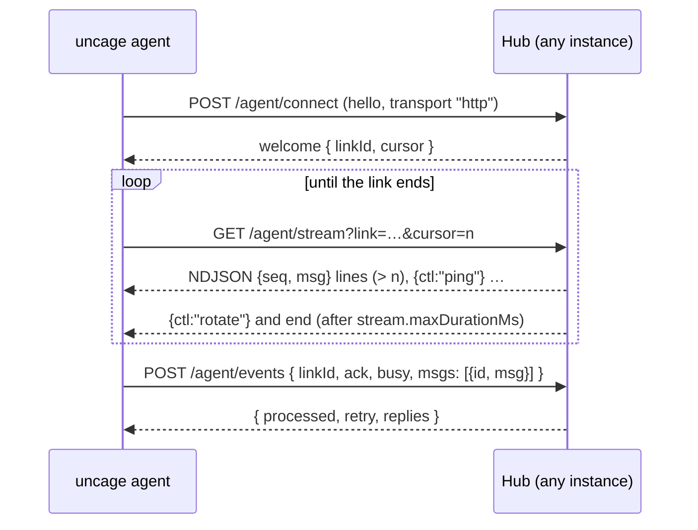

You rarely call these yourself: `@uncage/client` (and the React packages on top of it) does. They are listed here for custom clients, debugging and coding agents. Types for every body are in `@uncage/protocol`.

## Two servers, one API shape

| | Connected Mode hub | Local Mode daemon |
| --- | --- | --- |
| Base | `<publicUrl><basePath>` (default `/api/uncage`) | `http://127.0.0.1:4783/v1`, reached through your proxy at `/api/uncage` |
| Auth | Your cookies, via `getUser(req)` | `Authorization: Bearer <token>`, added by the proxy |
| Extra | `/machines`, device endpoints, `install.sh` / `install.ps1`, `/maintenance`, the agent transports | none |

The session, run, event and approval routes have the same request and response shapes in both. That is why the same client works against either: point it at `/api/uncage` and it talks to the hub or to the proxy.

## Browser API

All routes below need a signed-in user (`401 unauthorized` otherwise). Resources of another user answer `404`, the same as missing ones. Non-GET requests from another origin get `403 forbidden_origin`.

| Method and path | Body / query | Answer |
| --- | --- | --- |
| `GET /health` | | `{ ok: true, protocol: "1.0", version }` |
| `GET /runtimes` | `?machineId=` (optional) | `RuntimeInfo[]` of that computer, else of the first online one |
| `GET /machines` | | `MachineInfo[]`: `{ id, name, os, agentVersion, runtimes, online, lastSeenAt, agentOutdated, transport }`, most recently seen first. `agentOutdated`: the agent is older than `minAgentVersion` (show “Agent update needed”). `transport`: `'ws'`, `'http'` or `null` while offline |
| `GET /machines/install` | | `{ install, setup, windows }`: the commands to show (`curl … install.sh \| bash`, `uncage setup <url>`, `irm … install.ps1 \| iex`) |
| `DELETE /machines/:id` | | `{ ok: true }`. Revokes the computer |
| `GET /sessions` | | `Session[]`, each with `machineId`, oldest first |
| `POST /sessions` | `{ runtime, title?, machineId? }` | `201 Session`. Without `machineId`: the most recently seen online computer. `workspace` is ignored |
| `GET /sessions/:id` | | `SessionSnapshot`: `{ session, runs, pendingApprovals, lastSequence }` |
| `PATCH /sessions/:id/settings` | `{ model?, effort?, permissionMode? }` (at least one) | `Session` |
| `POST /sessions/:id/runs` | `{ prompt, attachmentIds? }` + header `Idempotency-Key` | `202 Run` |
| `GET /sessions/:id/events` | `?after=<sequence>` or header `Last-Event-ID` | SSE stream of `UncageEvent`s. With `Accept: application/json`: a JSON array (`?limit=`) |
| `POST /sessions/:id/attachments` | raw bytes; headers `Content-Type`, `X-Filename` (URI-encoded) | `Attachment`. At most 10 MiB (on Vercel, the platform refuses bodies over about 4.5 MB first) |
| `GET /attachments/:id` | | The file |
| `GET /runs?active=1` | | `ActiveRunInfo[]`: runs in progress in the user’s sessions |
| `GET /runs/:id` | | `Run` |
| `POST /runs/:id/cancel` | | `202` |
| `GET /approvals?sessionId=` | | Pending `ApprovalRequest[]` of that session |
| `POST /approvals/:id/decision` | `{ decision: "allow" \| "deny", scope: "once" \| "session", reason? }` + header `Idempotency-Key` | The updated `ApprovalRequest`. A second, different decision gets `409` |

The Local Mode daemon has the same routes under `/v1` except `/machines*`, and accepts `workspace` in `POST /v1/sessions` (inside its allowed roots).

### Server-sent events

`GET /sessions/:id/events` streams `text/event-stream`. Each event carries its sequence as the SSE `id`, so a reconnecting `EventSource` (or `@uncage/client`) resumes with `Last-Event-ID`. Comment lines are sent every 15 s (`sseHeartbeatMs`) to keep proxies from closing the stream. After `stream.maxDurationMs` (250 s by default) the hub sends `event: reconnect` with `data: {}` and ends the stream: reconnect at once with `Last-Event-ID` (`@uncage/client` does), and you get the following events without a gap or a duplicate. Events you will see: `session.created`, `session.updated`, `run.started`, `run.updated`, `run.completed`, `run.failed`, `run.cancelled`, `run.interrupted`, `message.started`, `message.delta`, `message.completed`, `tool.started`, `tool.updated`, `tool.completed`, `tool.failed`, `approval.requested`, `approval.updated`, `approval.resolved`, `system.warning`.

## Machine side (public)

Used by the CLI and the agent. They do not call `getUser`.

| Method and path | |
| --- | --- |
| `GET /install.sh` | The macOS / Linux installer (`text/plain`). Fixed content; only the CLI version range, the site URL and your `installScript` text vary |
| `GET /install.ps1` | The same installer for Windows PowerShell |
| `POST /device/code` | Starts a device login. Answers the user code, the verification link, the polling interval (2 s) and the expiry (600 s). Rate limited per client IP |
| `POST /device/token` | `{ deviceCode }`: polls until the user approves; then answers the machine token once, with the offered transports |
| `POST /machine/revoke` | `Authorization: Bearer <machine token>`: the computer revokes itself (`uncage sites remove`) |
| `GET /agent/info` | `{ protocol, minAgentVersion, transports: [{ kind, url }] }`: what the agent should speak. `kind` is `ws` (only when `attachWebSocket` runs, or `transports` lists it) or `http` |
| `GET /agent` (WebSocket upgrade) | The WebSocket transport (`Authorization: Bearer <machine token>`), served by `attachWebSocket(hub, server)`. Frames are JSON, at most 1 MiB each. Where no WebSocket server runs (FaaS mode), an upgrade request gets `426 upgrade_required` |
| `/agent/connect`, `/agent/stream`, `/agent/events`, `/agent/disconnect` | The HTTP streaming transport, below |
| `GET\|POST /maintenance` | Only with `maintenance.secret`: `Authorization: Bearer <secret>` runs maintenance now and answers `{ ran, pruned, interruptedToolCalls }` (`ran: false` when another instance ran it within `maintenance.intervalMs`). Without the secret: `404` |

## Agent transport (HTTP streaming)

The agent uses this when the hub offers only `http` (FaaS mode) or WebSockets keep failing. Every request carries `Authorization: Bearer <machine token>`; a missing or wrong token answers `401`, and too many of those from one IP `429` (`rateLimits.agentAuthFailuresPerMinute`). Any hub instance can serve any of these requests: the state lives in the store. The types are in `@uncage/protocol` (`HttpConnectResponse`, `StreamLine`, `HttpEventsRequest`, `HttpEventsResponse`).



### `POST /agent/connect`

Body: the agent’s `hello` frame, `{ "t": "hello", "protocol": 2, "agentVersion": "0.3.0", "transport": "http", "machine": { "name", "os", "runtimes" } }`. Answers:

- `200 { "t": "welcome", machineId, protocol, minAgentVersion, linkId, cursor, replies }`. `linkId` (`lnk_` + 24 hex) names this connection; `cursor` is the highest outbox sequence already acknowledged. A newer connect replaces the previous link.
- `426 { "t": "upgrade_required", minAgentVersion }`: the agent is too old (an older protocol, or below `minAgentVersion`). The hub marks the computer as outdated for the website.

### `GET /agent/stream?link=<linkId>&cursor=<n>`

`application/x-ndjson`, one JSON object per line:

| Line | Meaning |
| --- | --- |
| `{"seq":12,"msg":{…}}` | An outbox item: a hub frame (`command`, `tool_result`, `ack`, …) with its sequence number, always greater than `cursor`. Process it, then remember `seq`. |
| `{"ctl":"ping","at":…}` | Heartbeat, every `heartbeat.pingIntervalMs` (10 s). |
| `{"ctl":"rotate"}` | The hub ends this stream (after `stream.maxDurationMs`, or while shutting down). Reconnect at once with the same link and your cursor. |
| `{"ctl":"replaced"}` | A newer `connect` took over this link. Stop. |
| `{"ctl":"closed"}` | The link was closed but the computer still exists. `connect` again. |
| `{"ctl":"revoked"}` | The computer was revoked. Stop. |

Opening the stream **acknowledges** `cursor`: the hub deletes outbox items up to it, then streams the items after it. Reopening with the same cursor delivers the unprocessed items again, so a cut stream never loses one. Skip control lines you do not know. While the stream is idle, the hub polls the outbox every `polling.activeMs` (300 ms) while the computer is busy or something was delivered in the last `polling.activeWindowMs` (30 s), backing off to `polling.idleMs` (2 s); a command written on another instance wakes the stream through the cluster.

### `POST /agent/events`

```json
{ "linkId": "lnk_…", "ack": 12, "busy": true, "msgs": [{ "id": "up_3f9c…", "msg": { "t": "events", "sessionId": "…", "events": [] } }] }
```

- `msgs`: upstream frames (everything the agent sends except `hello` and `pong`), each with an idempotent id `up_` + 16–64 characters. At most 500 messages and **1 MiB per request body** (`MAX_HTTP_BODY_BYTES`); larger files travel as several chunks.
- `ack`: the highest outbox sequence processed, so the hub can delete delivered items without waiting for the next stream.
- `busy`: work is in flight on the computer (keeps the stream in its fast polling mode).

Answer: `{ "processed": [ids], "retry": [ids], "replies": [frames] }`. `processed` lists ids handled now or before (duplicates are recognized for 24 h and not applied again); drop them. `retry` lists ids the hub could not take yet (for example a tool call still running on another instance); send them again, in order, in a later request. Messages are applied strictly in order: processing stops at the first one that has to wait.

A site tool call (`tool_call`) runs its handler inside this request and its result comes back in `replies` (or later on the stream). A retried call with the same id returns the stored result instead of running again.

Errors specific to this route: `400 invalid_request` with `details.reason: 'link_replaced'` (stop: a newer connection exists) or `'link_closed'` (connect again).

### `POST /agent/disconnect`

`{ "linkId": "lnk_…" }`: closes the link so the computer shows offline at once. Answers `204`.

## Errors

Every error is JSON with the HTTP status of its code:

```json
{ "code": "machine_offline", "message": "The machine is offline.", "hint": "Make sure the Uncage agent is running on that machine and connected to the internet.", "retryable": true, "requestId": "req_…" }
```

`details` is added where useful (for example `details.reason`, `details.retryAfterSec`). The full list is in [Error codes](/docs/reference/errors/).
