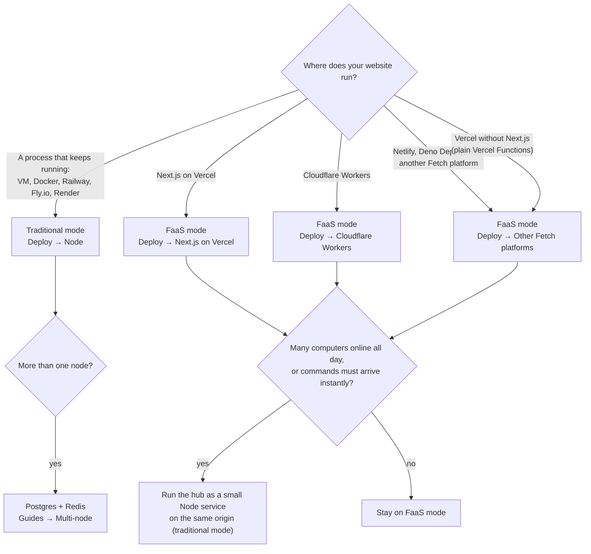

The hub (`@uncage/hub`) runs wherever your website runs. There are two ways to deploy it. They use the same hub, the same `createHub` options, the same site tools, skills and UI. Only three things differ: where the hub keeps its state, how users’ computers connect, and how you mount it.

- **Traditional mode**: your website is a long-running Node process (a VM, a container, Railway, Fly.io, Render, your own server). The hub keeps its data in an embedded database folder and holds a WebSocket to every connected computer. Nothing else to install.
- **FaaS mode**: your website runs as serverless functions or on a Fetch platform (Next.js on Vercel, Cloudflare Workers, Netlify, Deno Deploy, …). Function instances come and go, so the hub keeps everything in Postgres, and computers connect over **HTTP streaming**: a long request that the hub ends before the platform’s time limit and the agent reopens at once.

You do not have to tell the users’ computers which mode you use. The agent asks the hub which transports it offers (`GET <basePath>/agent/info`) and picks one by itself.

## Compare

| | Traditional mode | FaaS mode |
| --- | --- | --- |
| **Where your site runs** | A long-running Node.js 22+ process | Serverless functions or a Fetch platform |
| **Dependencies** | None: `pgliteHubStore` (embedded Postgres in a folder) and an in-memory cluster. Several nodes: Postgres + Redis | Postgres (`DATABASE_URL`). Redis optional |
| **Computers connect over** | WebSocket (HTTP streaming is offered too, as a fallback) | HTTP streaming (`/agent/stream` + `/agent/events`) |
| **Delay before a computer gets a command** | Immediate (pushed over the socket) | About 300 ms while a run is active; up to about 2 s after 30 s of quiet |
| **Cost shape** | One always-on process, whatever the number of computers | Each online computer holds about **one continuous function invocation** (its stream, reopened every ~250 s), plus database polling (below) |
| **Instances** | One by default; add nodes with Postgres + Redis | Always several (every function instance is a hub); no sticky sessions needed |
| **Platform limits to plan for** | The proxy in front must pass WebSocket upgrades | Function duration (Vercel: 300 s by default), request body size (Vercel: about 4.5 MB), CPU time (Workers) |
| **How you mount it** | `toNodeHandler(hub)` + `attachWebSocket(hub, server)` from `@uncage/hub/node` | `toNextHandlers(…)` (Next.js), `fetchOnce(…)` (Workers) or `hub.fetch(req)` |
| **Guide** | [Node (traditional)](/docs/deploy/node/) | [Next.js on Vercel](/docs/deploy/vercel/), [Cloudflare Workers](/docs/deploy/cloudflare-workers/), [Other Fetch platforms](/docs/deploy/other-fetch-platforms/) |

## Decide

Rules of thumb:

- **You already run a Node server**: traditional mode. It is the simplest and the fastest, and needs nothing new.
- **Your site is on Vercel, Workers or another serverless platform**: FaaS mode. Add a Postgres database and you are done; no second service to run.
- **Not sure yet**: start with whichever matches your site today. Switching later changes only the store, the cluster and a few lines of mounting code (see [switching later](#switching-later)).

## What FaaS mode costs

FaaS platforms bill for the time your functions run, in one form or another. Vercel (Fluid compute) bills active CPU time plus the memory provisioned for as long as an instance runs, so an open stream that mostly waits costs memory-time but little CPU. Cloudflare Workers bills CPU time only. In FaaS mode:

- **Each online computer keeps one request open**: its HTTP stream. The hub ends it after `stream.maxDurationMs` (250 s by default, below Vercel’s 300 s limit) and the agent reopens it at once. So a computer that stays online all day keeps a function instance busy all day, whether or not it does any work (on Vercel, several streams can share one instance). On Cloudflare Workers waiting for I/O does not count as CPU time.
- **Each open stream polls its computer’s outbox** in Postgres: every 300 ms while something happened in the last 30 s or a run is active, backing off to every 2 s when idle (`polling: { activeMs, idleMs, activeWindowMs }`). Measured on Postgres 16: about **0.5 queries per second per idle computer** and **2.3 per second while a run is active**.
- **`postgresCluster` polls too** (every 300 ms while busy, every 2 s when quiet, per instance), to pass wake-ups between instances.
- **Your database never sleeps while a computer is online.** A scale-to-zero Postgres (Neon’s free tier, for example) stays awake as long as any stream or instance is polling.

That is fine for a demo or a handful of users: the reference demo is designed to run on Vercel Hobby with a few computers online. It adds up when many computers stay online for hours.

### When to switch to traditional mode or add Redis

- **Many computers online all day** (dozens or more): function hours grow with every online computer. A single Node process (traditional mode) holds thousands of idle WebSockets for the price of one small server.
- **Commands must arrive instantly** (interactive tools where 300 ms to 2 s is noticeable): traditional mode pushes over WebSocket.
- **Database load from polling**: add Redis (`cluster: redisCluster({ url })`). Wake-ups between instances then travel over Redis pub/sub instead of a polled table, which removes the cluster polling and delivers a command to an idle computer’s stream at once. The outbox polling of each open stream stays.
- **Long site tool handlers** (minutes): FaaS functions have a time limit and every tool call runs inside one request. Run the hub where handlers can take as long as they need, or move the long work to a background job and return an id.

You can also keep your site on Vercel and run only the hub as a small Node service on the **same origin** (your edge routes `/api/uncage/*` to it). See [Node → FAQ](/docs/deploy/node/#faq).

## What is the same in both modes

- `createHub` options, `defineTool`, skills, `selectManifest`, `sessionStorage`, `getUser`, `<AgentChat>` and the `/device` approval page.
- **Guarantees.** A tool call runs **exactly once** when a connection drops (the call and its result are stored, ids are idempotent, the agent re-sends) (on FaaS platforms: when the hub is given the platform's `waitUntil`; see [Workers → FAQ](/docs/deploy/cloudflare-workers/#do-site-tools-run-exactly-once-on-workers)). If the instance running your handler is stopped mid-call (a crash, a deploy, a platform time limit), the call runs **at most once**: it fails with “Site tool "<name>" timed out on the website. Please try again.” and is never re-run by itself. Events, approvals and file pulls are neither lost nor duplicated across drops, stream rotations and retries. Details: [Define tools → When connections drop](/docs/guides/define-tools/#when-connections-drop-or-instances-stop).
- **Security.** Rate limits and failed-code counters are stored in the hub’s store, so every node and every function instance shares one count.

## Switching later

Your tools, skills, sign-in and pages do not change. What changes:

| From → to | Change |
| --- | --- |
| Traditional → FaaS | `store`: `pgliteHubStore` → `postgresHubStore`. Add `cluster: postgresCluster(…)` (or Redis). Mount with `toNextHandlers` / `fetchOnce` / `hub.fetch` instead of `toNodeHandler` + `attachWebSocket`. Set `stream.maxDurationMs` below the platform limit. |
| FaaS → traditional | Mount with `toNodeHandler` + `attachWebSocket` in a Node server. Keep `postgresHubStore` (no data moves), or switch to `pgliteHubStore` for a single node. |

Connected computers follow the switch by themselves when the database stays the same: the agent re-reads the offered transports. **A new database means new pairings**: computers paired with the old store are unknown to the new one and must run `uncage setup <url>` again.
