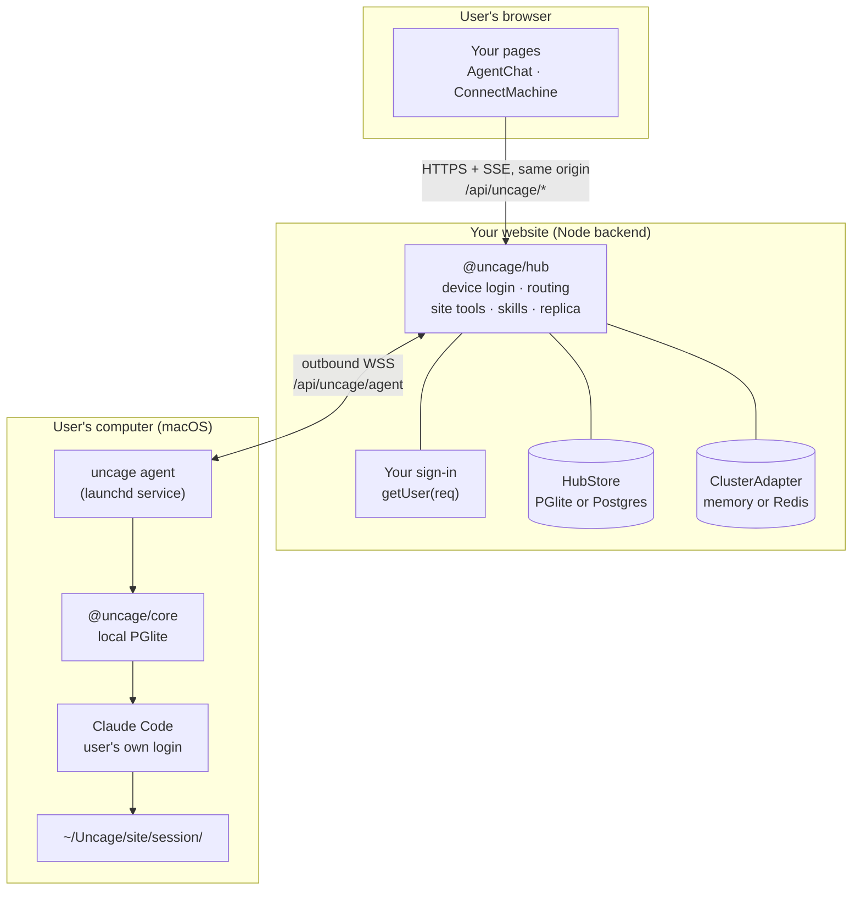
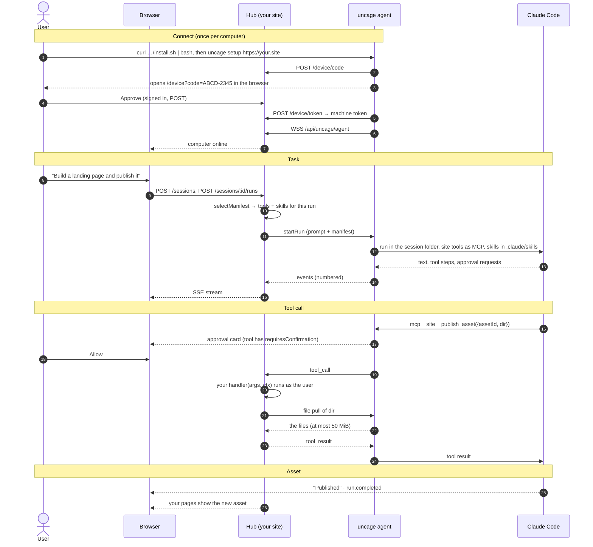

Connected Mode has three places where code runs. Only one of them is yours to deploy.



- **The browser** talks only to your website, under `/api/uncage/*`, with the user’s normal session cookie. `<AgentChat>` from `@uncage/react-ui` does this for you.
- **Your website** mounts `@uncage/hub` in its Node backend. The hub does device login, keeps a WebSocket to every connected computer, routes browser requests to the right computer, runs your site tools, and (optionally) keeps a copy of every conversation.
- **The user’s computer** runs `uncage agent`, a background service installed by `uncage setup`. It dials **out** to your hub over WSS, so the user needs no public IP, port forwarding or tunnel. It runs Claude Code through `@uncage/core`, the same engine as Local Mode, in a fresh folder per session.

The session’s source of truth is the user’s computer (its local PGlite database). The hub stores an index of sessions, and with `sessionStorage: 'site'` an append-only replica of their events.

## What happens, step by step



### 1. Connect

1. Your page shows two commands. `<ConnectMachine>` renders them from the hub (`GET /api/uncage/machines/install`):

   ```sh
   curl -fsSL https://your.site/api/uncage/install.sh | bash
   uncage setup https://your.site
   ```

2. `install.sh` is a fixed script served by the hub. It checks macOS, Node.js 22+ and npm, says how to install Claude Code if it is missing, and installs `@uncage/cli` globally. It downloads nothing else.
3. `uncage setup` starts a device login. It gets an 8-character code (valid for 10 minutes) and opens `https://your.site/device?code=…`.
4. The user, signed in to your site, checks the code and clicks **Approve**. Your approval page calls `hub.approveDevice(code, user)`. This binds the computer to that user.
5. The CLI receives a **machine token** (random, one per computer and website), saves it in `~/.uncage/agent.yaml` (mode 0600), and installs the agent as a launchd service.
6. The agent connects to `wss://your.site/api/uncage/agent`. Your page switches from “Waiting for your computer…” to “Connected”.

### 2. Send a task

1. The user types in `<AgentChat>`. The browser calls the hub’s browser API (the same shapes as the Local Mode daemon’s `/v1` API).
2. For every run, the hub calls your `selectManifest({ user, prompt, sessionId, runtime })` to pick the tools and skills this run may use. Without it, every registered tool and skill is offered. A runtime without site tool support (Codex) gets the skills only, and the session shows a `site_tools_unsupported` warning.
3. The hub sends `startRun` to the computer with the prompt and the **manifest**: the tools’ names, descriptions and JSON Schemas, and the skills’ text. No code.
4. The agent runs Claude Code in `~/Uncage/<site host>/<session id>/`. Site tools appear to Claude Code as `mcp__site__<name>`. Skills are written to `.claude/skills/<name>/SKILL.md` in that folder.
5. Every event (text, tool steps, approvals, run state) is numbered and stored locally first, then sent to the hub and on to the browser over SSE.

### 3. Claude Code calls your tool

1. Claude Code calls `mcp__site__publish_asset`. If the tool has `requiresConfirmation: true`, the user first gets an approval card in your UI, even in `bypassPermissions` mode.
2. The agent sends a `tool_call` to the hub. The node that holds the computer’s WebSocket runs the handler, after checking that the session belongs to this computer and its user, and that the tool was in the run’s manifest.
3. Your handler gets `ctx.user` (the session owner), `ctx.sessionId`, `ctx.runId`, `ctx.signal` and `ctx.files`. `ctx.files.pull('landing')` asks the agent for that folder of the session workspace. The agent refuses paths outside the workspace and never follows symlinks.
4. The handler’s return value goes back to Claude Code as the tool result. Every call is recorded in the hub’s store.

### 4. The result lives on your site

Your handler stored the files, so your own pages can show them. With `sessionStorage: 'site'` the conversation is replicated to your store too. Reload the page with the computer switched off and the whole process is still there; the composer says the computer is offline until it reconnects.

## Where things are stored

| What | Where |
| --- | --- |
| Machine token | Only in `~/.uncage/agent.yaml` on the user’s computer (mode 0600). The hub keeps a SHA-256 hash. |
| Session data (truth) | The user’s computer, `~/.uncage/sites/<site id>/data` (PGlite) |
| Session workspace | `~/Uncage/<site host>/<session id>/` on the user’s computer |
| Activity log | `~/.uncage/sites/<site id>/activity.log` on the user’s computer (`uncage activity`) |
| Machines, session index, tool-call audit | The hub’s `HubStore` (PGlite by default, Postgres for several nodes) |
| Conversation replica | The hub’s `HubStore`, only with `sessionStorage: 'site'` |
| Files your tools pulled | Wherever your handler puts them |

## Next

- [Connected Mode quickstart](/uncage/start/quickstart-connected/): build all of this into a Next.js app.
- [Concepts](/uncage/concepts/): the vocabulary, one section per idea.
- [Trust model](/uncage/concepts/trust-model/): what a website can and cannot do on a user’s computer.
