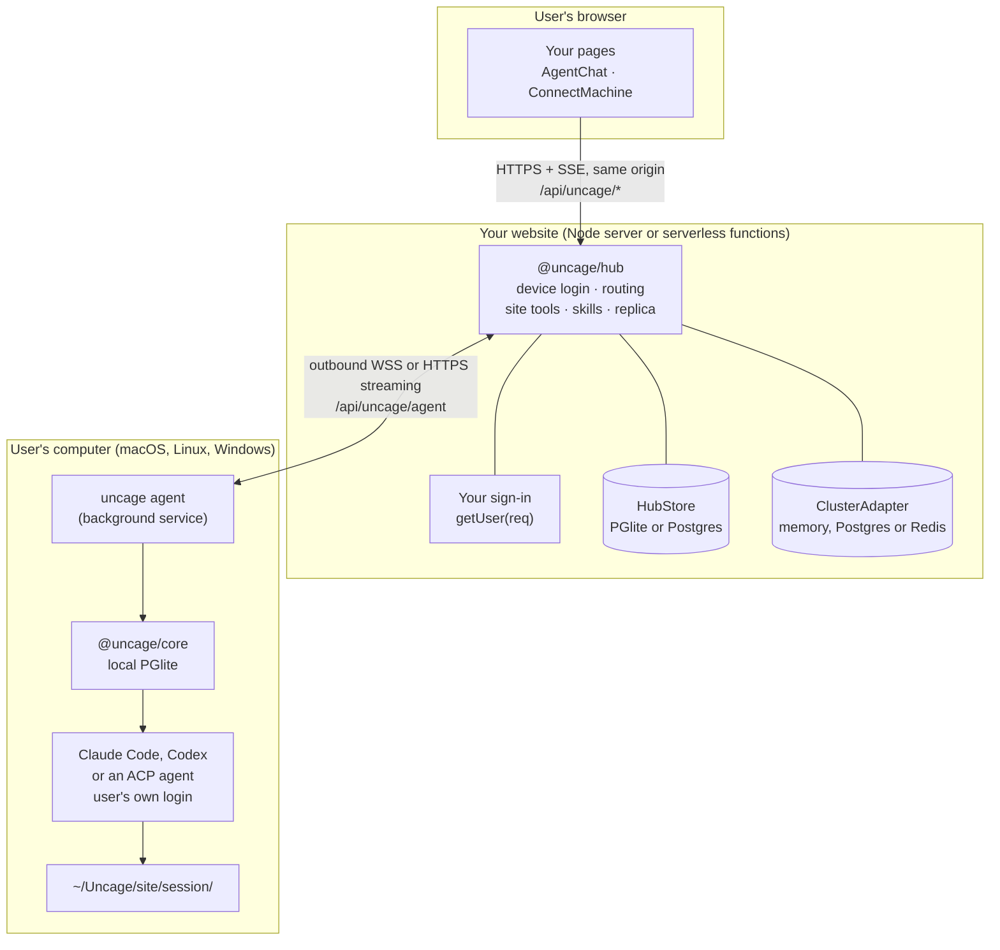
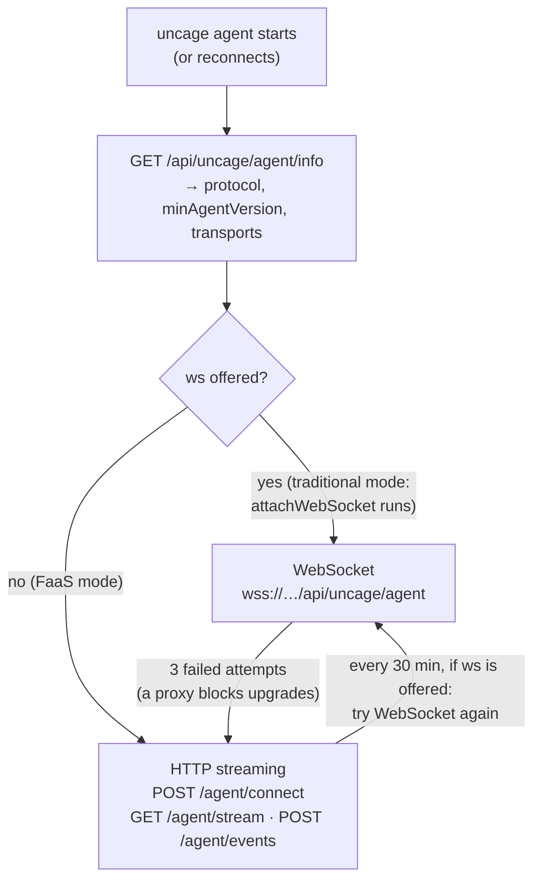

Connected Mode has three places where code runs. Only one of them is yours to deploy.



- **The browser** talks only to your website, under `/api/uncage/*`, with the user’s normal session cookie. `<AgentChat>` from `@uncage/react-ui` does this for you.
- **Your website** mounts `@uncage/hub`, in a long-running Node process (traditional mode) or in serverless functions (FaaS mode, see [Choose a deployment mode](/docs/start/choose-deployment-mode/)). The hub does device login, keeps every connected computer reachable, routes browser requests to the right computer, runs your site tools, and (optionally) keeps a copy of every conversation.
- **The user’s computer** runs `uncage agent`, a per-user background service installed by `uncage setup`. It dials **out** to your hub (WebSocket or HTTPS streaming, see [below](#how-a-computer-connects)), so the user needs no public IP, port forwarding or tunnel. It runs the user’s coding agent through `@uncage/core`, the same engine as Local Mode, in a fresh folder per session: Claude Code, Codex, or any agent that speaks the [Agent Client Protocol](/docs/guides/use-any-acp-agent/) (Gemini CLI, OpenCode, …). ACP agents installed on the computer are found by themselves, from the ACP registry, and enabled only after they answer the protocol handshake; one that would be downloaded (`npx`, `uvx`) never runs until the user consents with `uncage runtimes enable <id>`.

The session’s source of truth is the user’s computer (its local PGlite database). The hub stores an index of sessions, and with `sessionStorage: 'site'` an append-only replica of their events.

## How a computer connects

The hub offers one or two **transports**, and the agent picks one by itself. The developer only chooses where the hub runs.



- **WebSocket** (traditional mode). One connection carries everything both ways; the hub pushes commands at once and pings every 10 s.
- **HTTP streaming** (FaaS mode, and the fallback in traditional mode). Downstream, the agent holds `GET <basePath>/agent/stream?cursor=<n>` open: the hub writes the computer’s commands to a durable **outbox** in its store, each with a sequence number, and streams them as NDJSON lines. Before the platform’s time limit (`stream.maxDurationMs`, 250 s by default) the hub ends the stream with a `rotate` line and the agent reopens it at once, with the cursor of the last line it processed. Upstream, the agent sends events, tool calls and file chunks with `POST <basePath>/agent/events`, in batches of at most 1 MB; every message carries an idempotent id, so a retried POST is never applied twice. The stream polls the outbox every 300 ms while a run is active and backs off to 2 s when idle. Any function instance can serve any request: there is no state in memory.

Either way the computer is **online** while its connection is live (WebSocket answering pings, or a stream open), and offline about 30 s after it goes silent. Routes and frames: [HTTP API → Agent transport](/docs/reference/http-api/#agent-transport-http-streaming).

## What happens, step by step


### 1. Connect

1. Your page shows one command, for the user’s operating system. `<ConnectMachine>` renders it from the hub (`GET /api/uncage/machines/install`) and starts on the tab of the visitor’s OS:

   ```sh
   curl -fsSL https://your.site/api/uncage/install.sh | bash        # macOS, Linux
   irm https://your.site/api/uncage/install.ps1 | iex               # Windows PowerShell
   ```

   For a computer that already has the CLI, it also shows `uncage setup https://your.site`.

2. `install.sh` (macOS, Linux) and `install.ps1` (Windows) are fixed scripts served by the hub. They check the computer (OS, Node.js 22+, npm, an installed coding agent) and ask `[Y/n]` before each step they need: Node.js through the user’s own version manager when there is one (nvm, fnm, volta, …; never `sudo`, never admin rights, the default Node version is not changed without a yes), a user-owned npm folder if the global one is not writable, then `@uncage/cli`. They never install the coding agent itself; they point to Claude Code’s installer if none is found. At the end they offer to run `uncage setup` for this website. Details per OS: [Install on your computer](/docs/start/install-on-your-computer/).
3. `uncage setup` starts a device login. It gets an 8-character code (valid for 10 minutes) and opens `https://your.site/device?code=…`.
4. The user, signed in to your site, checks the code and clicks **Approve**. Your approval page calls `hub.approveDevice(code, user)`. This binds the computer to that user.
5. The CLI receives a **machine token** (random, one per computer and website), saves it in `~/.uncage/agent.yaml` (mode 0600), and installs the agent as a per-user background service (launchd on macOS, a systemd user service on Linux, a scheduled task on Windows) that runs the exact Node.js it was installed with.
6. The agent connects ([WebSocket or HTTP streaming](#how-a-computer-connects)). Your page switches from “Waiting for your computer…” to “Connected”.

### 2. Send a task

1. The user types in `<AgentChat>`. The browser calls the hub’s browser API (the same shapes as the Local Mode daemon’s `/v1` API).
2. For every run, the hub calls your `selectManifest({ user, prompt, sessionId, runtime })` to pick the tools and skills this run may use. Without it, every registered tool and skill is offered. A runtime without site tool support (Codex) gets the skills only, and the session shows a `site_tools_unsupported` warning. (The Codex runtime receives the skills but does not use them yet.)
3. The hub sends `startRun` to the computer with the prompt and the **manifest**: the tools’ names, descriptions and JSON Schemas, and the skills’ text. No code.
4. The agent runs the session’s runtime in `~/Uncage/<site host>/<session id>/`. Site tools appear to Claude Code as `mcp__site__<name>`. Skills are written to `.claude/skills/<name>/SKILL.md` in that folder (ACP agents get them as text in the first prompt).
5. Every event (text, tool steps, approvals, run state) is numbered and stored locally first, then sent to the hub and on to the browser over SSE.

### 3. Claude Code calls your tool

1. Claude Code calls `mcp__site__publish_asset`. If the tool has `requiresConfirmation: true`, the user first gets an approval card in your UI, even in `bypassPermissions` mode.
2. The agent sends a `tool_call` to the hub. The hub instance that receives it (the node holding the WebSocket, or whichever function instance gets the POST) runs the handler, after checking that the session belongs to this computer and its user, and that the tool was in the run’s manifest.
3. Your handler gets `ctx.user` (the session owner), `ctx.sessionId`, `ctx.runId`, `ctx.signal` and `ctx.files`. `ctx.files.pull('landing')` asks the agent for that folder of the session workspace. The agent refuses paths outside the workspace and never follows symlinks.
4. The handler’s return value goes back to Claude Code as the tool result. Every call, and its result, is recorded in the hub’s store.

### 4. The result lives on your site

Your handler stored the files, so your own pages can show them. With `sessionStorage: 'site'` the conversation is replicated to your store too. Reload the page with the computer switched off and the whole process is still there; the composer says the computer is offline until it reconnects.

## When something fails

| What happens | Result |
| --- | --- |
| A connection drops (network, proxy, a stream rotation) | Nothing is lost or done twice. The agent reconnects with its cursor; commands it has not processed are delivered again, and its own messages are re-sent with the same ids, which the hub deduplicates. A site tool call is stored with its result, so a re-sent call gets the stored result: **exactly once** (on FaaS platforms: when the hub is given the platform's `waitUntil`; see [Workers → FAQ](/docs/deploy/cloudflare-workers/#do-site-tools-run-exactly-once-on-workers)). Runs keep going on the computer meanwhile, and events backfill. |
| The hub instance running a site tool handler is stopped (crash, deploy, platform time limit) | **At most once**: the call fails with “Site tool "<name>" timed out on the website. Please try again.” once its lease ends (`toolTimeoutMs` + 10 s), and is never re-run by itself. Claude Code sees the error and usually tries again. Stored results are kept 24 h. |
| The agent process on the computer crashes or restarts | Commands the hub delivered but the agent had not acknowledged yet are delivered again and run after the restart. A command it had acknowledged but not answered times out on the website (`commandTimeoutMs`, 30 s): the user retries. |
| The computer goes offline | The website shows it offline within about 30 s. With `sessionStorage: 'site'` the history stays readable. |
| An agent older than the hub’s `minAgentVersion` connects | Over WebSocket it is told to upgrade and does so itself. In FaaS mode the website shows “Agent update needed” with the command to run. |

## Where things are stored

| What | Where |
| --- | --- |
| Machine token | Only in `~/.uncage/agent.yaml` on the user’s computer (mode 0600). The hub keeps a SHA-256 hash. |
| Session data (truth) | The user’s computer, `~/.uncage/sites/<site id>/data` (PGlite) |
| Session workspace | `~/Uncage/<site host>/<session id>/` on the user’s computer |
| Activity log | `~/.uncage/sites/<site id>/activity.log` on the user’s computer (`uncage activity`) |
| Machines, session index, tool-call audit, outbox | The hub’s `HubStore` (PGlite in traditional mode, Postgres for several nodes and FaaS mode) |
| Conversation replica | The hub’s `HubStore`, only with `sessionStorage: 'site'` |
| Files your tools pulled | Wherever your handler puts them |

## Next

- [Choose a deployment mode](/docs/start/choose-deployment-mode/): traditional or FaaS.
- [Connected Mode quickstart](/docs/start/quickstart-connected/): build all of this into a Next.js app.
- [Concepts](/docs/concepts/): the vocabulary, one section per idea.
- [Trust model](/docs/concepts/trust-model/): what a website can and cannot do on a user’s computer.
