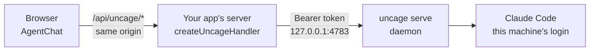

Local Mode is for apps that run on the **same machine** as the agent: a developer dashboard, an internal tool, a desktop-style app. The daemon `uncage serve` runs Claude Code under that machine’s Claude login; your app reaches it through a same-origin proxy that adds the daemon token on the server.

If your users each have their own computer, use [Connected Mode](/docs/start/quickstart-connected/) instead.

## Copy prompt for your coding agent

```text wrap
Add Uncage Local Mode to this Next.js (App Router) app, following https://uncage.vercel.app/docs/start/quickstart-local.md exactly.
1. npm i @uncage/server @uncage/react-ui @uncage/cli
2. Create app/api/uncage/[...path]/route.ts with createUncageHandler from @uncage/server/proxy (runtime 'nodejs', dynamic 'force-dynamic', export GET, POST, PATCH).
3. Create a page that renders <UncageProvider><AgentChat /></UncageProvider> from @uncage/react-ui inside a full-height container, and import '@uncage/react-ui/styles.css'.
Do not expose the daemon token to the browser and do not call the daemon from client code directly.
Verify: run "npx uncage doctor" and report each line; with "npx uncage serve --workspace <this repo>" running in another terminal and the app on http://localhost:3000, curl -s http://localhost:3000/api/uncage/runtimes returns a JSON array that contains "claude".
```

## 1. Prerequisites

- macOS, Linux or Windows, and Node.js **22 or newer** (`node -v`). `uncage serve` runs wherever the CLI does; macOS is verified on real devices, Linux and Windows are CI verified and await real-device confirmation.
- Claude Code installed and signed in: `npm i -g @anthropic-ai/claude-code`, then run `claude` once and type `/login`.
- A Next.js (App Router) app. Starting fresh: `npx create-next-app@latest my-app` (TypeScript, App Router).

## 2. Install

```sh
npm i @uncage/server @uncage/react-ui @uncage/cli
```

## 3. Add two files

The route handler is a same-origin proxy. It reads the daemon token on the server, so the token never reaches the browser.

```ts title="app/api/uncage/[...path]/route.ts"
import { createUncageHandler } from '@uncage/server/proxy';

export const runtime = 'nodejs';
export const dynamic = 'force-dynamic';
export const { GET, POST, PATCH } = createUncageHandler();
```

```tsx title="app/page.tsx"
'use client';
import { AgentChat, UncageProvider } from '@uncage/react-ui';
import '@uncage/react-ui/styles.css';

export default function Page() {
  return (
    <div style={{ height: '100vh' }}>
      <UncageProvider>
        <AgentChat locale="en" />
      </UncageProvider>
    </div>
  );
}
```

`locale` is `'en'` (the default) or `'zh-CN'`.

## 4. Start the daemon

Leave it running in its own terminal:

```sh
npx uncage serve --workspace /absolute/path/to/the/project/the/agent/works/in
```

`--workspace` is the folder the agent reads and edits. On first start the daemon creates `~/.uncage/token` (mode 600) and `~/.uncage/data`, then prints:

```text
Uncage listening on http://127.0.0.1:4783 · workspace /…/project · runtimes: claude ✓, codex ✗ (not installed)
```

Check everything with `npx uncage doctor`. Every line is ✓ or ✗, and every ✗ prints the exact `fix:` command. Codex showing “not installed” is fine; it is optional.

## 5. Run your app

```sh
npm run dev
```

Open `http://localhost:3000`, pick **Claude Code**, and ask something like “Scan this repo and run the tests”.

- Commands and file edits show an approval card: **Allow once** / **Deny**.
- **Stop** cancels the run and kills its processes.
- Refresh any time: `<AgentChat>` keeps the open conversation in `?session=<id>`, so history and pending approvals come back.

## How it fits together



The browser talks only to your app. Your app’s server forwards to the daemon on `127.0.0.1:4783` with the token. The daemon runs Claude Code on the same machine. It is not a multi-tenant cloud service: don’t expose it to the internet or share one Claude login among many users.

## Other frameworks

- **Fetch-style servers** (Remix / React Router, SvelteKit, Hono, Bun): `createUncageHandler()` returns standard `(Request) => Promise<Response>` handlers. Mount them under `/api/uncage/*` (or pass `basePath`).
- **Express, Connect, Fastify, `node:http`**: use `createUncageNodeHandler()` from `@uncage/server/proxy`, mounted before any body parser:

```ts title="server.ts (Express)"
import express from 'express';
import { createUncageNodeHandler } from '@uncage/server/proxy';

const app = express();
app.use('/api/uncage', createUncageNodeHandler()); // before express.json() and compression()
app.listen(3000);
```

- **A Vite or webpack SPA with a separate backend**: keep the browser’s `Host` in the dev proxy (`changeOrigin: false`). With `changeOrigin: true` every POST gets 403 `forbidden_origin`, because the proxy compares `Origin` with the rewritten `Host`.

[Local Mode in depth](/docs/reference/local-mode/) covers the composer, attachments, configuration (`uncage.config.yaml`) and the Local Mode security model. The [CLI reference](/docs/reference/cli/) lists every flag.

## Next

- [Custom UI with hooks](/docs/guides/custom-ui/): build your own chat with `@uncage/react`.
- [Troubleshooting](/docs/reference/troubleshooting/): `forbidden_origin`, ports, sign-in.
