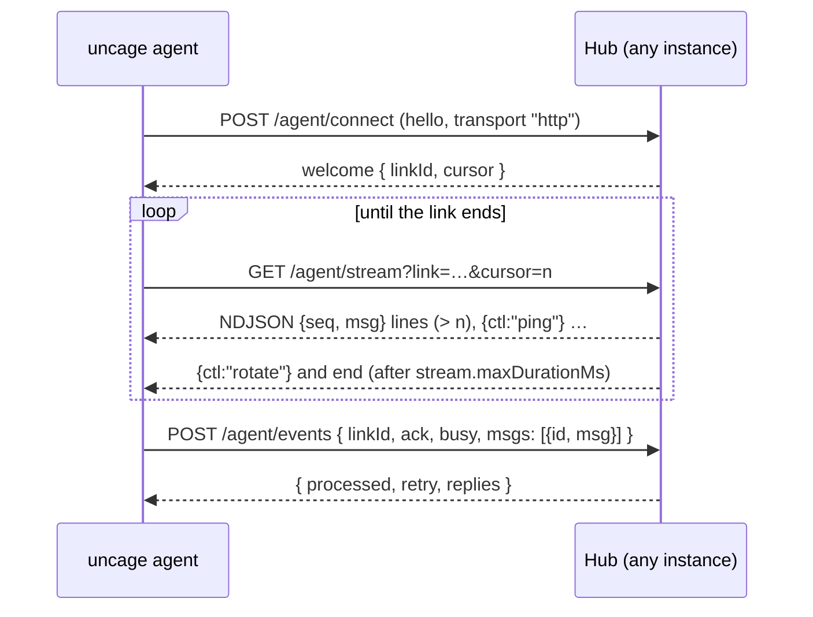

你很少需要自己调用这些接口：`@uncage/client`（以及基于它的 React 包）会替你调用。这里列出它们，供自定义客户端、调试和 coding agent 参考。所有请求体的类型都在 `@uncage/protocol` 里。

## 两种服务器，同一套 API 形状

| | Connected 模式的 hub | Local 模式的 Uncage 服务 |
| --- | --- | --- |
| 基础地址 | `<publicUrl><basePath>`（默认 `/api/uncage`） | `http://127.0.0.1:4783/v1`，通过你在 `/api/uncage` 的代理访问 |
| 认证 | 你的 cookie，经由 `getUser(req)` | `Authorization: Bearer <token>`，由代理添加 |
| 额外内容 | `/machines`、设备端点、`install.sh` / `install.ps1`、`/maintenance`、守护进程的传输方式 | 无 |

会话、运行、事件和审批路由在两者中的请求和响应形状相同。所以同一个客户端两边都能用：把它指向 `/api/uncage`，它就会和 hub 或代理通信。

## 浏览器 API

下面所有路由都需要已登录用户（否则返回 `401 unauthorized`）。其他用户的资源返回 `404`，和不存在的资源一样。来自其他源的非 GET 请求得到 `403 forbidden_origin`。

| 方法和路径 | 请求体 / 查询参数 | 响应 |
| --- | --- | --- |
| `GET /health` | | `{ ok: true, protocol: "1.0", version }` |
| `GET /runtimes` | `?machineId=`（可选） | 那台电脑的 `RuntimeInfo[]`，不指定时为第一台在线电脑的 |
| `GET /machines` | | `MachineInfo[]`：`{ id, name, os, agentVersion, runtimes, online, lastSeenAt, agentOutdated, transport }`，最近在线的排在最前。`agentOutdated`：守护进程版本低于 `minAgentVersion`（应显示“需要更新守护进程”）。`transport`：`'ws'`、`'http'`，离线时为 `null` |
| `GET /machines/install` | | `{ install, setup, windows }`：要展示的命令（`curl … install.sh \| bash`、`uncage setup <url>`、`irm … install.ps1 \| iex`） |
| `DELETE /machines/:id` | | `{ ok: true }`。吊销这台电脑 |
| `GET /sessions` | | `Session[]`，每个都带 `machineId`，最早的排在最前 |
| `POST /sessions` | `{ runtime, title?, machineId? }` | `201 Session`。不传 `machineId` 时使用最近在线的电脑。`workspace` 会被忽略 |
| `GET /sessions/:id` | | `SessionSnapshot`：`{ session, runs, pendingApprovals, lastSequence }` |
| `PATCH /sessions/:id/settings` | `{ model?, effort?, permissionMode? }`（至少一项） | `Session` |
| `POST /sessions/:id/runs` | `{ prompt, attachmentIds? }` + 请求头 `Idempotency-Key` | `202 Run` |
| `GET /sessions/:id/events` | `?after=<sequence>` 或请求头 `Last-Event-ID` | `UncageEvent` 的 SSE 流。带 `Accept: application/json` 时返回 JSON 数组（`?limit=`） |
| `POST /sessions/:id/attachments` | 原始字节；请求头 `Content-Type`、`X-Filename`（URI 编码） | `Attachment`。最大 10 MiB（在 Vercel 上，平台会先拒绝超过约 4.5 MB 的请求体） |
| `GET /attachments/:id` | | 文件本身 |
| `GET /runs?active=1` | | `ActiveRunInfo[]`：该用户各会话中正在进行的运行 |
| `GET /runs/:id` | | `Run` |
| `POST /runs/:id/cancel` | | `202` |
| `GET /approvals?sessionId=` | | 该会话待处理的 `ApprovalRequest[]` |
| `POST /approvals/:id/decision` | `{ decision: "allow" \| "deny", scope: "once" \| "session", reason? }` + 请求头 `Idempotency-Key` | 更新后的 `ApprovalRequest`。第二个不同的决定会得到 `409` |

Local 模式的 Uncage 服务在 `/v1` 下有同样的路由，但没有 `/machines*`，并且在 `POST /v1/sessions` 里接受 `workspace`（必须位于允许的根目录之内）。

### Server-sent events

`GET /sessions/:id/events` 以 `text/event-stream` 推送。每个事件都把自己的序号作为 SSE 的 `id`，所以重连的 `EventSource`（或 `@uncage/client`）可以通过 `Last-Event-ID` 继续。每 15 秒（`sseHeartbeatMs`）发送一行注释，防止代理关闭事件流。经过 `stream.maxDurationMs`（默认 250 秒）后，hub 会发送 `event: reconnect`（`data: {}`）并结束事件流：请立即带着 `Last-Event-ID` 重连（`@uncage/client` 会自动这样做），之后的事件既不会有空缺，也不会重复。你会看到这些事件：`session.created`、`session.updated`、`run.started`、`run.updated`、`run.completed`、`run.failed`、`run.cancelled`、`run.interrupted`、`message.started`、`message.delta`、`message.completed`、`tool.started`、`tool.updated`、`tool.completed`、`tool.failed`、`approval.requested`、`approval.updated`、`approval.resolved`、`system.warning`。

## 电脑一侧（公开）

供 CLI 和守护进程使用。它们不调用 `getUser`。

| 方法和路径 | |
| --- | --- |
| `GET /install.sh` | macOS / Linux 安装脚本（`text/plain`）。内容固定；只有 CLI 版本范围、网站 URL 和你的 `installScript` 文本会变化 |
| `GET /install.ps1` | 同一个安装脚本的 Windows PowerShell 版本 |
| `POST /device/code` | 发起设备登录。返回验证码、验证链接、轮询间隔（2 秒）和过期时间（600 秒）。按客户端 IP 限流 |
| `POST /device/token` | `{ deviceCode }`：轮询直到用户批准；然后返回一次机器令牌，同时列出 hub 提供的传输方式 |
| `POST /machine/revoke` | `Authorization: Bearer <machine token>`：电脑吊销自己（`uncage sites remove`） |
| `GET /agent/info` | `{ protocol, minAgentVersion, transports: [{ kind, url }] }`：守护进程应该使用的协议。`kind` 为 `ws`（仅当运行了 `attachWebSocket`，或 `transports` 中列出了它）或 `http` |
| `GET /agent`（WebSocket 升级） | WebSocket 传输方式（`Authorization: Bearer <machine token>`），由 `attachWebSocket(hub, server)` 提供。帧为 JSON，每帧最大 1 MiB。在没有运行 WebSocket 服务器的地方（FaaS 模式），升级请求会得到 `426 upgrade_required` |
| `/agent/connect`、`/agent/stream`、`/agent/events`、`/agent/disconnect` | HTTP 流式传输，见下文 |
| `GET\|POST /maintenance` | 仅在设置了 `maintenance.secret` 时存在：带上 `Authorization: Bearer <secret>` 会立即运行维护任务，并返回 `{ ran, pruned, interruptedToolCalls }`（如果另一个实例在 `maintenance.intervalMs` 内已经运行过，则 `ran: false`）。没有设置 secret 时返回 `404` |

## 守护进程的传输方式（HTTP 流式传输）

当 hub 只提供 `http`（FaaS 模式），或者 WebSocket 连续失败时，守护进程使用这种方式。每个请求都带 `Authorization: Bearer <machine token>`；令牌缺失或错误时返回 `401`，同一 IP 的这类请求过多时返回 `429`（`rateLimits.agentAuthFailuresPerMinute`）。任何 hub 实例都能处理其中任何一个请求：状态存在 store 里。类型在 `@uncage/protocol` 中（`HttpConnectResponse`、`StreamLine`、`HttpEventsRequest`、`HttpEventsResponse`）。



### `POST /agent/connect`

请求体：守护进程的 `hello` 帧，`{ "t": "hello", "protocol": 2, "agentVersion": "0.3.0", "transport": "http", "machine": { "name", "os", "runtimes" } }`。响应：

- `200 { "t": "welcome", machineId, protocol, minAgentVersion, linkId, cursor, replies }`。`linkId`（`lnk_` + 24 位十六进制）标识这条连接；`cursor` 是已确认的 outbox 最大序号。新的 connect 会取代之前的 link。
- `426 { "t": "upgrade_required", minAgentVersion }`：守护进程版本太旧（协议版本更旧，或低于 `minAgentVersion`）。hub 会为网站把这台电脑标记为版本过旧。

### `GET /agent/stream?link=<linkId>&cursor=<n>`

`application/x-ndjson`，每行一个 JSON 对象：

| 行 | 含义 |
| --- | --- |
| `{"seq":12,"msg":{…}}` | 一个 outbox 条目：hub 发出的帧（`command`、`tool_result`、`ack` 等）及其序号，总是大于 `cursor`。处理它，然后记下 `seq`。 |
| `{"ctl":"ping","at":…}` | 心跳，每 `heartbeat.pingIntervalMs`（10 秒）一次。 |
| `{"ctl":"rotate"}` | hub 结束这条流（在 `stream.maxDurationMs` 之后，或正在关闭时）。立即用同一个 link 和你的游标重连。 |
| `{"ctl":"replaced"}` | 新的 `connect` 接管了这个 link。停止。 |
| `{"ctl":"closed"}` | link 已关闭，但电脑仍然存在。重新 `connect`。 |
| `{"ctl":"revoked"}` | 电脑已被吊销。停止。 |

打开流即**确认**了 `cursor`：hub 删除序号不超过它的 outbox 条目，然后流式发送它之后的条目。用同一个游标重新打开，会再次送达尚未处理的条目，所以流被切断也不会丢失任何一条。遇到不认识的控制行请跳过。流空闲时，如果电脑正忙或者最近 `polling.activeWindowMs`（30 秒）内有过送达，hub 每 `polling.activeMs`（300 ms）轮询一次 outbox，否则退避到 `polling.idleMs`（2 秒）；在其他实例上写入的命令会通过 cluster 唤醒这条流。

### `POST /agent/events`

```json
{ "linkId": "lnk_…", "ack": 12, "busy": true, "msgs": [{ "id": "up_3f9c…", "msg": { "t": "events", "sessionId": "…", "events": [] } }] }
```

- `msgs`：上行帧（守护进程发送的所有内容，`hello` 和 `pong` 除外），每条带一个幂等 id，格式为 `up_` + 16–64 个字符。每个请求最多 500 条消息、**请求体最大 1 MiB**（`MAX_HTTP_BODY_BYTES`）；更大的文件分成多个块传输。
- `ack`：已处理的 outbox 最大序号，这样 hub 不必等到下一条流就能删除已送达的条目。
- `busy`：电脑上有工作正在进行（让流保持快速轮询模式）。

响应：`{ "processed": [ids], "retry": [ids], "replies": [frames] }`。`processed` 列出本次或之前已处理的 id（重复的 id 在 24 小时内都能被识别，不会再次应用）；把它们丢弃即可。`retry` 列出 hub 暂时无法接收的 id（例如一个仍在其他实例上运行的工具调用）；请在之后的请求中按顺序再次发送。消息严格按顺序应用：处理到第一条需要等待的消息时就会停下。

网站工具调用（`tool_call`）在这个请求中运行 handler，结果在 `replies` 中返回（或稍后通过流返回）。用相同 id 重试的调用会返回已存储的结果，而不会再运行一次。

这个路由特有的错误：`400 invalid_request`，带 `details.reason: 'link_replaced'`（停止：已经有更新的连接）或 `'link_closed'`（重新连接）。

### `POST /agent/disconnect`

`{ "linkId": "lnk_…" }`：关闭这个 link，让电脑立即显示为离线。返回 `204`。

## 错误

每个错误都是 JSON，HTTP 状态码与错误码对应：

```json
{ "code": "machine_offline", "message": "The machine is offline.", "hint": "Make sure the Uncage agent is running on that machine and connected to the internet.", "retryable": true, "requestId": "req_…" }
```

在有用的地方会附加 `details`（例如 `details.reason`、`details.retryAfterSec`）。完整列表见[错误码](/docs/zh-cn/reference/errors/)。
