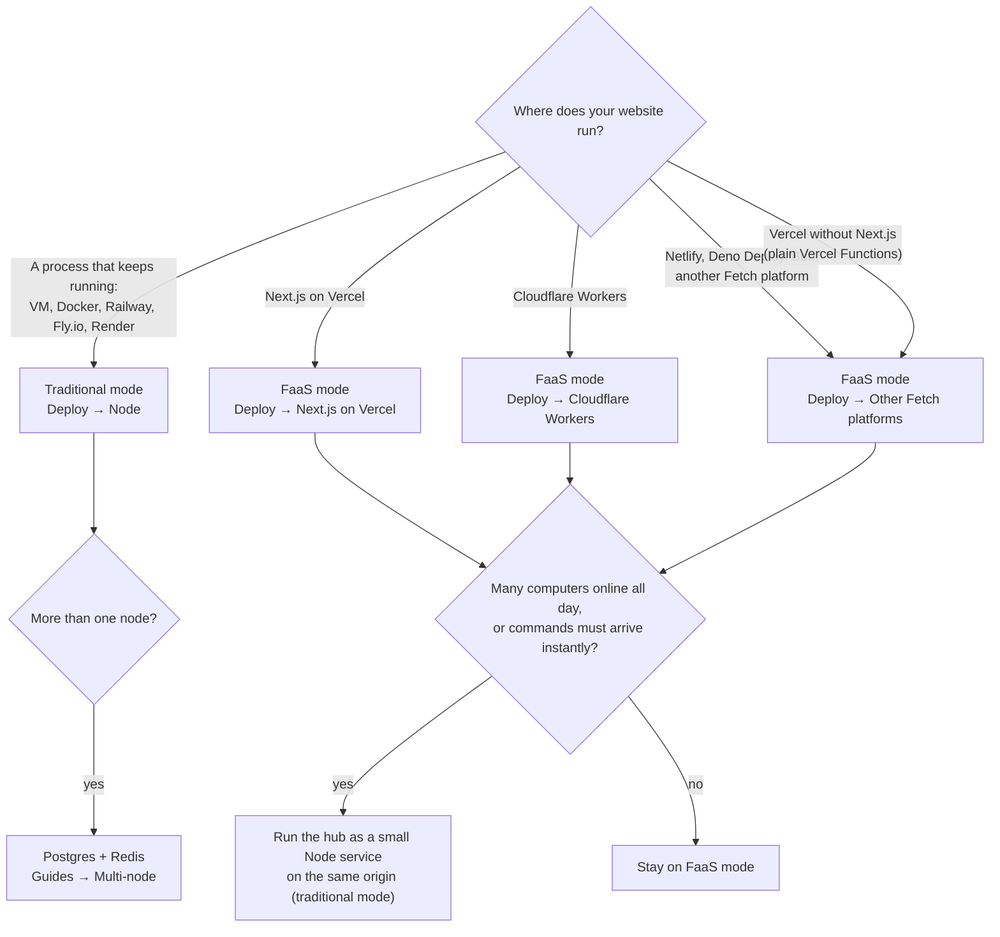

hub（`@uncage/hub`）跟着你的网站走：网站在哪里运行，hub 就在哪里运行。部署方式有两种。两种方式用的是同一个 hub、同样的 `createHub` 选项、同样的网站工具、技能和 UI，区别只有三点：hub 把状态存在哪里、用户的电脑怎么连接、以及你怎么挂载它。

- **传统模式**：你的网站是一个长期运行的 Node 进程（虚拟机、容器、Railway、Fly.io、Render 或你自己的服务器）。hub 把数据存在一个嵌入式数据库目录里，并和每台已连接的电脑各保持一条 WebSocket。不需要额外安装任何东西。
- **FaaS 模式**：你的网站以 Serverless 函数的形式运行，或者运行在 Fetch 平台上（Vercel 上的 Next.js、Cloudflare Workers、Netlify、Deno Deploy 等）。函数实例随时创建、随时回收，所以 hub 把所有状态都存进 Postgres，电脑则通过 **HTTP 流式传输**连接：一个长时间保持的请求，hub 会在平台超时之前主动结束它，守护进程随即重新打开。

你不需要告诉用户的电脑你用的是哪种模式。守护进程会询问 hub 提供哪些传输方式（`GET <basePath>/agent/info`），然后自己选一种。

## 对比

| | 传统模式 | FaaS 模式 |
| --- | --- | --- |
| **网站运行在哪里** | 长期运行的 Node.js 22+ 进程 | Serverless 函数或 Fetch 平台 |
| **依赖** | 无：`pgliteHubStore`（放在一个目录里的嵌入式 Postgres）加内存中的 cluster。多节点时：Postgres + Redis | Postgres（`DATABASE_URL`）。Redis 可选 |
| **电脑的连接方式** | WebSocket（同时也提供 HTTP 流式传输作为后备） | HTTP 流式传输（`/agent/stream` + `/agent/events`） |
| **电脑收到命令前的延迟** | 即时（通过 socket 推送） | 有任务运行时约 300 ms；安静 30 s 之后最长约 2 s |
| **成本构成** | 一个常驻进程，与电脑数量无关 | 每台在线电脑大约占用**一个持续的函数调用**（它的流，约每 250 s 重开一次），外加数据库轮询（见下文） |
| **实例** | 默认一个；用 Postgres + Redis 增加节点 | 总是多个（每个函数实例都是一个 hub）；不需要粘性会话 |
| **需要考虑的平台限制** | 前面的代理必须放行 WebSocket 升级 | 函数时长（Vercel 默认 300 s）、请求体大小（Vercel 约 4.5 MB）、CPU 时间（Workers） |
| **挂载方式** | `@uncage/hub/node` 中的 `toNodeHandler(hub)` + `attachWebSocket(hub, server)` | `toNextHandlers(…)`（Next.js）、`fetchOnce(…)`（Workers）或 `hub.fetch(req)` |
| **指南** | [Node（传统模式）](/docs/zh-cn/deploy/node/) | [Vercel 上的 Next.js](/docs/zh-cn/deploy/vercel/)、[Cloudflare Workers](/docs/zh-cn/deploy/cloudflare-workers/)、[其他 Fetch 平台](/docs/zh-cn/deploy/other-fetch-platforms/) |

## 决策

经验法则：

- **你已经在运行 Node 服务器**：用传统模式。它最简单、最快，也不需要任何新东西。
- **你的网站在 Vercel、Workers 或其他 Serverless 平台上**：用 FaaS 模式。加一个 Postgres 数据库就够了，不需要再运行第二个服务。
- **还没想好**：先选和你网站现状相符的那种。以后切换只需要改动 store、cluster 和几行挂载代码（见[以后切换](#以后切换)）。

## FaaS 模式的成本

FaaS 平台都会以某种形式按函数运行时间计费。Vercel（Fluid compute）按活跃 CPU 时间加上实例运行期间预留的内存计费，所以一条大部分时间都在等待的流，花的主要是内存时长，CPU 很少。Cloudflare Workers 只按 CPU 时间计费。在 FaaS 模式下：

- **每台在线电脑保持一个打开的请求**：它的 HTTP 流。hub 在 `stream.maxDurationMs`（默认 250 s，低于 Vercel 的 300 s 上限）之后结束这个请求，守护进程立即重新打开。因此一台全天在线的电脑会让一个函数实例全天忙着，无论它有没有在干活（在 Vercel 上，多条流可以共用一个实例）。在 Cloudflare Workers 上，等待 I/O 不计入 CPU 时间。
- **每条打开的流都会在 Postgres 里轮询所属电脑的 outbox**：最近 30 s 内有动静或有任务在运行时每 300 ms 一次，空闲时退避到每 2 s 一次（`polling: { activeMs, idleMs, activeWindowMs }`）。在 Postgres 16 上实测：每台空闲电脑约**每秒 0.5 次查询**，有任务运行时约**每秒 2.3 次**。
- **`postgresCluster` 也会轮询**（每个实例在繁忙时每 300 ms 一次，安静时每 2 s 一次），用来在实例之间传递唤醒信号。
- **只要有电脑在线，你的数据库就不会休眠。** 能缩容到零的 Postgres（例如 Neon 的免费套餐）只要还有流或实例在轮询，就会一直保持唤醒。

对演示或少量用户来说，这完全没问题：参考演示的设计目标就是在 Vercel Hobby 上同时支撑几台在线电脑。但如果很多电脑一连几个小时在线，成本就会累积起来。

### 什么时候改用传统模式或加上 Redis

- **很多电脑全天在线**（几十台甚至更多）：函数时长随在线电脑数量增长。一个 Node 进程（传统模式）只要一台小服务器的价钱，就能撑住成千上万条空闲的 WebSocket。
- **命令必须即时到达**（对 300 ms 到 2 s 的延迟敏感的交互式工具）：传统模式通过 WebSocket 推送。
- **轮询给数据库带来压力**：加上 Redis（`cluster: redisCluster({ url })`）。这样实例之间的唤醒信号走 Redis pub/sub，而不是轮询一张表，既去掉了 cluster 的轮询，也能让命令立即送达空闲电脑的流。每条打开的流对 outbox 的轮询仍然保留。
- **网站工具的 handler 要跑很久**（几分钟）：FaaS 函数有时间上限，而每次工具调用都在一个请求里执行。要么把 hub 放到 handler 想跑多久就能跑多久的地方，要么把耗时的工作交给后台任务，先返回一个 id。

你也可以让网站留在 Vercel 上，只把 hub 作为一个小型 Node 服务运行在**同源**下（由你的边缘层把 `/api/uncage/*` 路由过去）。见 [Node → 常见问题](/docs/zh-cn/deploy/node/#常见问题)。

## 两种模式相同的部分

- `createHub` 选项、`defineTool`、技能、`selectManifest`、`sessionStorage`、`getUser`、`<AgentChat>` 和 `/device` 审批页。
- **保证。** 连接断开时，工具调用**恰好执行一次**（调用和结果都会存储，id 是幂等的，守护进程会重发；在 FaaS 平台上的前提是把平台的 `waitUntil` 交给 hub，见 [Workers → 常见问题](/docs/zh-cn/deploy/cloudflare-workers/#在-workers-上网站工具会恰好执行一次吗)）。如果运行 handler 的实例在调用中途被停止（崩溃、部署、平台时间上限），这次调用**最多执行一次**：它会以“Site tool "<name>" timed out on the website. Please try again.”失败，并且不会自动重试。无论连接断开、流轮换还是重试，事件、审批和文件拉取都不会丢失，也不会重复。详见[定义网站工具 → 连接断开或实例停止时](/docs/zh-cn/guides/define-tools/#连接断开或实例停止时)。
- **安全。** 限流计数和验证码失败计数都存在 hub 的 store 里，所以所有节点、所有函数实例共用同一个计数。

## 以后切换

你的工具、技能、登录和页面都不用改。需要改的是：

| 从 → 到 | 改动 |
| --- | --- |
| 传统 → FaaS | `store`：`pgliteHubStore` → `postgresHubStore`。加上 `cluster: postgresCluster(…)`（或 Redis）。用 `toNextHandlers` / `fetchOnce` / `hub.fetch` 挂载，取代 `toNodeHandler` + `attachWebSocket`。把 `stream.maxDurationMs` 设得低于平台上限。 |
| FaaS → 传统 | 在 Node 服务器里用 `toNodeHandler` + `attachWebSocket` 挂载。保留 `postgresHubStore`（数据不用迁移），或者单节点时改用 `pgliteHubStore`。 |

只要数据库不变，已连接的电脑会自动跟上切换：守护进程会重新读取 hub 提供的传输方式。**换了数据库就要重新配对**：和旧 store 配对的电脑，新 store 并不认识，必须重新运行 `uncage setup <url>`。
