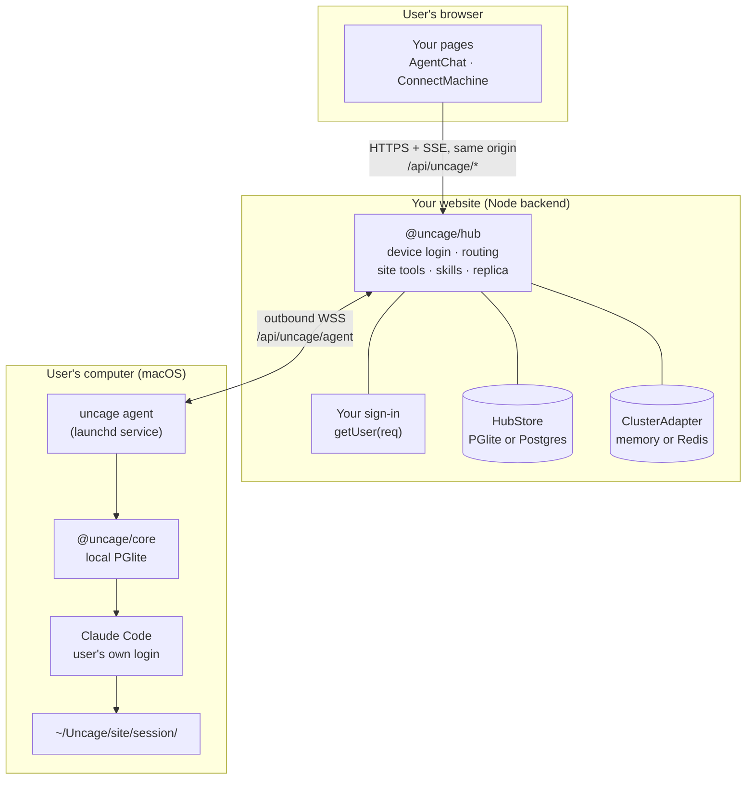
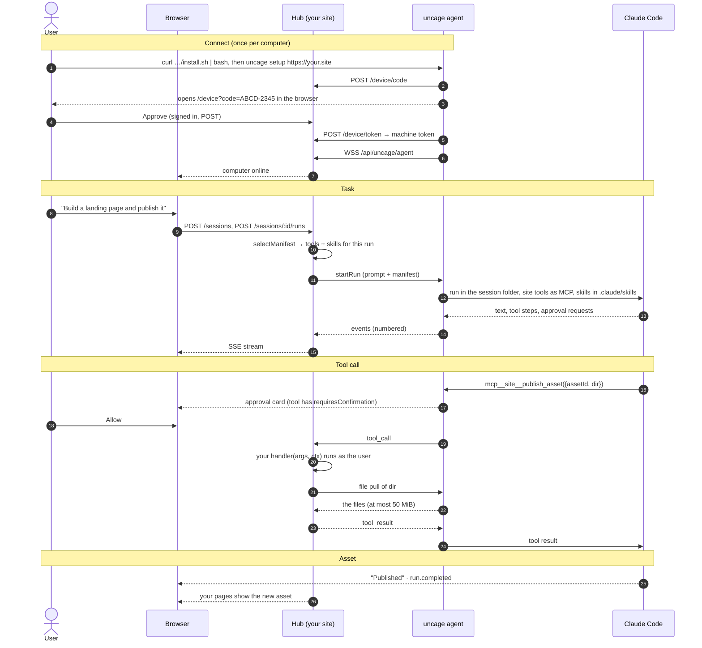

Connected 模式的代码运行在三个地方，其中只有一个需要你来部署。



- **浏览器**只和你的网站通信，路径在 `/api/uncage/*` 下，带着用户平常的登录 cookie。`@uncage/react-ui` 里的 `<AgentChat>` 已经替你做好了。
- **你的网站**在 Node 后端里挂上 `@uncage/hub`。hub 负责设备登录，和每台已连接的电脑保持一条 WebSocket，把浏览器请求路由到对应的电脑，执行你的网站工具，并且（可选）保存每段对话的副本。
- **用户的电脑**上运行 `uncage agent`，这是 `uncage setup` 安装的后台守护进程。它通过 WSS **主动连出**到你的 hub，所以用户不需要公网 IP、端口转发或内网穿透。它通过 `@uncage/core`（和 Local 模式用的是同一个引擎）运行 Claude Code，每个会话一个全新的目录。

会话数据以用户电脑为准（存在本地 PGlite 数据库里）。hub 保存会话索引；配置 `sessionStorage: 'site'` 时，还会保存这些会话事件的只追加副本。

## 一步一步发生了什么



### 1. 连接

1. 你的页面显示两条命令。`<ConnectMachine>` 从 hub 读取它们（`GET /api/uncage/machines/install`）：

   ```sh
   curl -fsSL https://your.site/api/uncage/install.sh | bash
   uncage setup https://your.site
   ```

2. `install.sh` 是 hub 提供的固定脚本：检查 macOS、Node.js 22+ 和 npm，缺 Claude Code 时告诉用户怎么装，然后全局安装 `@uncage/cli`。它不会下载其他任何东西。
3. `uncage setup` 发起设备登录：拿到一个 8 位的码（10 分钟内有效），并打开 `https://your.site/device?code=…`。
4. 已登录你网站的用户核对这个码，点击**批准**。你的审批页调用 `hub.approveDevice(code, user)`，把这台电脑绑定到该用户。
5. CLI 拿到一个**机器令牌**（随机生成，每台电脑每个网站一枚），存到 `~/.uncage/agent.yaml`（权限 0600），并把守护进程安装成 launchd 服务。
6. 守护进程连上 `wss://your.site/api/uncage/agent`。你的页面从“等待你的电脑上线…”变成“已连接”。

### 2. 发任务

1. 用户在 `<AgentChat>` 里输入。浏览器调用 hub 的浏览器 API（和 Local 模式 Uncage 服务（`uncage serve`）的 `/v1` API 形状相同）。
2. 每次运行开始时，hub 调用你的 `selectManifest({ user, prompt, sessionId, runtime })`，挑出这次运行可以用的工具和技能。不配置时，所有注册过的工具和技能都会提供。不支持网站工具的运行时（Codex）只拿到技能，会话里会显示 `site_tools_unsupported` 警告。
3. hub 把提示词和**清单**一起通过 `startRun` 发给电脑：清单里是工具的名称、描述和 JSON Schema，以及技能的文本。没有代码。
4. 守护进程在 `~/Uncage/<站点主机名>/<会话 id>/` 里运行 Claude Code。网站工具在 Claude Code 里显示为 `mcp__site__<名称>`。技能写到该目录下的 `.claude/skills/<名称>/SKILL.md`。
5. 每个事件（文本、工具步骤、审批、运行状态）都有序号，先写入本地，再发给 hub，然后经 SSE 推给浏览器。

### 3. Claude Code 调用你的工具

1. Claude Code 调用 `mcp__site__publish_asset`。如果工具设置了 `requiresConfirmation: true`，用户会先在你的界面上看到审批卡片，即使是 `bypassPermissions` 模式也一样。
2. 守护进程把 `tool_call` 发给 hub。持有这台电脑 WebSocket 的节点运行 handler，在此之前会检查：会话属于这台电脑和它的用户，且这个工具在本次运行的清单里。
3. 你的 handler 拿到 `ctx.user`（会话所属用户）、`ctx.sessionId`、`ctx.runId`、`ctx.signal` 和 `ctx.files`。`ctx.files.pull('landing')` 会向守护进程请求会话工作区里的这个文件夹。守护进程拒绝工作区以外的路径，也从不跟随符号链接。
4. handler 的返回值作为工具结果交还给 Claude Code。每次调用都记录在 hub 的存储里。

### 4. 结果留在你的网站上

handler 已经把文件存好，你自己的页面就能展示它们。配置 `sessionStorage: 'site'` 后，对话也会复制到你的存储里。关掉用户电脑再刷新页面，整个过程仍然都在；输入框会提示电脑离线，直到它重新连上。

## 数据存在哪里

| 什么 | 在哪里 |
| --- | --- |
| 机器令牌 | 只在用户电脑的 `~/.uncage/agent.yaml`（权限 0600）。hub 只保存它的 SHA-256 哈希。 |
| 会话数据（以此为准） | 用户电脑，`~/.uncage/sites/<站点 id>/data`（PGlite） |
| 会话工作区 | 用户电脑上的 `~/Uncage/<站点主机名>/<会话 id>/` |
| 活动日志 | 用户电脑上的 `~/.uncage/sites/<站点 id>/activity.log`（`uncage activity`） |
| 电脑、会话索引、工具调用审计 | hub 的 `HubStore`（默认 PGlite，多节点用 Postgres） |
| 对话副本 | hub 的 `HubStore`，仅当 `sessionStorage: 'site'` |
| 工具拉取的文件 | 你的 handler 放在哪里就在哪里 |

## 下一步

- [Connected 模式快速上手](/docs/zh-cn/start/quickstart-connected/)：把这一切接进一个 Next.js 应用。
- [概念](/docs/zh-cn/concepts/)：术语，一个概念一节。
- [信任模型](/docs/zh-cn/concepts/trust-model/)：网站在用户电脑上能做什么、不能做什么。
