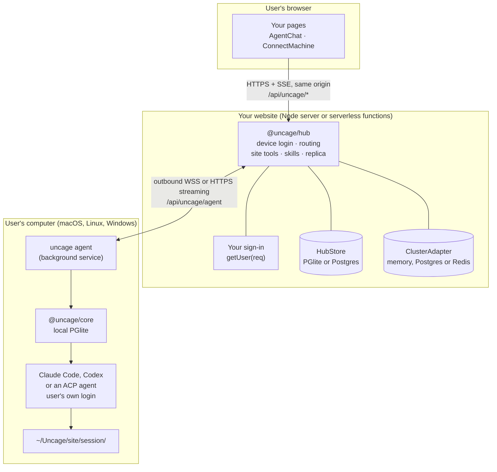
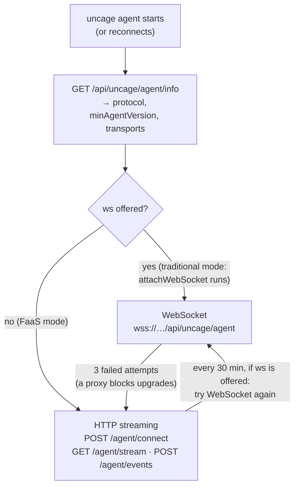

Connected 模式的代码运行在三个地方，其中只有一个需要你来部署。



- **浏览器**只和你的网站通信，路径在 `/api/uncage/*` 下，带着用户平常的登录 cookie。`@uncage/react-ui` 里的 `<AgentChat>` 已经替你做好了。
- **你的网站**挂上 `@uncage/hub`，可以在长期运行的 Node 进程里（传统模式），也可以在 Serverless 函数里（FaaS 模式，见[选择部署模式](/docs/zh-cn/start/choose-deployment-mode/)）。hub 负责设备登录，保证每台已连接的电脑随时可达，把浏览器请求路由到对应的电脑，执行你的网站工具，并且（可选）保存每段对话的副本。
- **用户的电脑**上运行 `uncage agent`，这是 `uncage setup` 安装的、按用户运行的后台守护进程。它**主动连出**到你的 hub（WebSocket 或 HTTPS 流式传输，见[下文](#电脑如何连接)），所以用户不需要公网 IP、端口转发或内网穿透。它通过 `@uncage/core`（和 Local 模式用的是同一个引擎）运行用户的 coding agent，每个会话一个全新的目录：Claude Code、Codex，或任何支持 [Agent Client Protocol](/docs/zh-cn/guides/use-any-acp-agent/) 的 agent（Gemini CLI、OpenCode 等）。电脑上已安装的 ACP agent 会从 ACP registry 自动发现，并且只有在回应了协议握手之后才会启用；需要下载的 agent（`npx`、`uvx`）在用户通过 `uncage runtimes enable <id>` 同意之前绝不会运行。

会话数据以用户电脑为准（存在本地 PGlite 数据库里）。hub 保存会话索引；配置 `sessionStorage: 'site'` 时，还会保存这些会话事件的只追加副本。

## 电脑如何连接

hub 提供一种或两种**传输方式**，守护进程自己从中选一种。开发者只需要决定 hub 运行在哪里。



- **WebSocket**（传统模式）。一条连接承载双向的全部通信；hub 即时推送命令，每 10 s 发一次 ping。
- **HTTP 流式传输**（FaaS 模式，也是传统模式下的后备）。下行方向，守护进程保持 `GET <basePath>/agent/stream?cursor=<n>` 处于打开状态：hub 把发给这台电脑的命令写进 store 中持久化的 **outbox**，每条带一个序号，再以 NDJSON 行的形式流式发出。在平台时间上限之前（`stream.maxDurationMs`，默认 250 s），hub 发出一行 `rotate` 结束这条流，守护进程立即带着最后处理过的那一行的游标重新打开。上行方向，守护进程用 `POST <basePath>/agent/events` 发送事件、工具调用和文件分块，每批最多 1 MB；每条消息都带一个幂等 id，所以重试的 POST 永远不会被应用两次。有任务运行时，流每 300 ms 轮询一次 outbox，空闲时退避到 2 s。任何函数实例都能处理任何请求：内存里没有状态。

无论哪种方式，只要连接是活的（WebSocket 在回应 ping，或者有一条流处于打开状态），电脑就是**在线**的；连接沉默约 30 s 后显示离线。路由和帧格式：见 [HTTP API → 守护进程的传输方式](/docs/zh-cn/reference/http-api/#守护进程的传输方式http-流式传输)。

## 一步一步发生了什么


### 1. 连接

1. 你的页面按用户的操作系统显示一条命令。`<ConnectMachine>` 从 hub 读取它（`GET /api/uncage/machines/install`），并默认打开访问者操作系统对应的标签页：

   ```sh
   curl -fsSL https://your.site/api/uncage/install.sh | bash        # macOS, Linux
   irm https://your.site/api/uncage/install.ps1 | iex               # Windows PowerShell
   ```

   对于已经装好 CLI 的电脑，它还会显示 `uncage setup https://your.site`。

2. `install.sh`（macOS、Linux）和 `install.ps1`（Windows）是 hub 提供的固定脚本。它们会检查电脑（操作系统、Node.js 22+、npm、已安装的 coding agent），并在每个需要执行的步骤之前询问 `[Y/n]`：如果用户有自己的版本管理器（nvm、fnm、volta 等），就用它安装 Node.js（绝不使用 `sudo`，绝不需要管理员权限，不经用户同意也不会更改默认的 Node 版本）；如果全局 npm 目录不可写，就改用一个用户自己的 npm 目录；最后安装 `@uncage/cli`。它们从不安装 coding agent 本身；如果没找到，会给出 Claude Code 安装程序的地址。最后，它们会询问是否为这个网站运行 `uncage setup`。各操作系统的细节见[在你的电脑上安装](/docs/zh-cn/start/install-on-your-computer/)。
3. `uncage setup` 发起设备登录：拿到一个 8 位验证码（10 分钟内有效），并打开 `https://your.site/device?code=…`。
4. 已登录你网站的用户核对验证码，点击**批准**。你的审批页调用 `hub.approveDevice(code, user)`，把这台电脑绑定到该用户。
5. CLI 拿到一个**机器令牌**（随机生成，每台电脑每个网站一枚），存到 `~/.uncage/agent.yaml`（权限 0600），并把守护进程安装成按用户运行的后台服务（macOS 上是 launchd，Linux 上是 systemd 用户服务，Windows 上是计划任务），服务使用的正是安装时的那个 Node.js。
6. 守护进程建立连接（[WebSocket 或 HTTP 流式传输](#电脑如何连接)）。你的页面从“等待你的电脑上线…”变成“已连接”。

### 2. 发任务

1. 用户在 `<AgentChat>` 里输入。浏览器调用 hub 的浏览器 API（和 Local 模式 Uncage 服务的 `/v1` API 形状相同）。
2. 每次运行开始时，hub 调用你的 `selectManifest({ user, prompt, sessionId, runtime })`，挑出这次运行可以用的工具和技能。不配置时，所有注册过的工具和技能都会提供。不支持网站工具的运行时（Codex）只拿到技能，会话里会显示 `site_tools_unsupported` 警告。（Codex 运行时会收到技能，但目前还不使用。）
3. hub 把提示词和**清单**一起通过 `startRun` 发给电脑：清单里是工具的名称、描述和 JSON Schema，以及技能的文本。没有代码。
4. 守护进程在 `~/Uncage/<site host>/<session id>/` 里运行这个会话的运行时。网站工具在 Claude Code 里显示为 `mcp__site__<name>`。技能写到该目录下的 `.claude/skills/<name>/SKILL.md`（ACP agent 则在第一条提示词里以文本形式收到）。
5. 每个事件（文本、工具步骤、审批、运行状态）都有序号，先写入本地，再发给 hub，然后经 SSE 推给浏览器。

### 3. Claude Code 调用你的工具

1. Claude Code 调用 `mcp__site__publish_asset`。如果工具设置了 `requiresConfirmation: true`，用户会先在你的界面上看到审批卡片，即使是 `bypassPermissions` 模式也一样。
2. 守护进程把 `tool_call` 发给 hub。收到它的 hub 实例（持有 WebSocket 的节点，或者接到这个 POST 的那个函数实例）运行 handler，在此之前会检查：会话属于这台电脑和它的用户，且这个工具在本次运行的清单里。
3. 你的 handler 拿到 `ctx.user`（会话所属用户）、`ctx.sessionId`、`ctx.runId`、`ctx.signal` 和 `ctx.files`。`ctx.files.pull('landing')` 会向守护进程请求会话工作区里的这个文件夹。守护进程拒绝工作区以外的路径，也从不跟随符号链接。
4. handler 的返回值作为工具结果交还给 Claude Code。每次调用及其结果都记录在 hub 的存储里。

### 4. 结果留在你的网站上

handler 已经把文件存好，你自己的页面就能展示它们。配置 `sessionStorage: 'site'` 后，对话也会复制到你的存储里。关掉用户电脑再刷新页面，整个过程仍然都在；输入框会提示电脑离线，直到它重新连上。

## 出故障时会怎样

| 发生了什么 | 结果 |
| --- | --- |
| 连接断开（网络、代理、流轮换） | 什么都不会丢失，也不会重复执行。守护进程带着游标重连；还没处理的命令会重新送达，它自己发出的消息会用相同的 id 重发，由 hub 去重。网站工具调用会连同结果一起存储，所以重发的调用拿到的是已存储的结果：**恰好一次**（在 FaaS 平台上的前提是把平台的 `waitUntil` 交给 hub；见 [Workers → 常见问题](/docs/zh-cn/deploy/cloudflare-workers/#在-workers-上网站工具会恰好执行一次吗)）。与此同时，任务在电脑上继续运行，事件之后会补齐。 |
| 正在运行网站工具 handler 的 hub 实例被停止（崩溃、部署、平台时间上限） | **最多一次**：等租期（`toolTimeoutMs` + 10 s）结束，这次调用会以“Site tool "<name>" timed out on the website. Please try again.”失败，并且不会自动重试。Claude Code 会看到这个错误，通常会再试一次。已存储的结果保留 24 h。 |
| 电脑上的守护进程崩溃或重启 | hub 已经送达、但守护进程还没确认的命令会重新送达，并在重启后执行。已经确认、但还没给出应答的命令会在网站上超时（`commandTimeoutMs`，30 s）：由用户重试。 |
| 电脑离线 | 网站在约 30 s 内显示它离线。配置 `sessionStorage: 'site'` 时，历史记录仍然可以查看。 |
| 版本低于 hub 的 `minAgentVersion` 的守护进程连接 | 通过 WebSocket 连接时，它会被告知需要升级，并自行升级。在 FaaS 模式下，网站会显示“需要更新守护进程”以及要运行的命令。 |

## 数据存在哪里

| 什么 | 在哪里 |
| --- | --- |
| 机器令牌 | 只在用户电脑的 `~/.uncage/agent.yaml`（权限 0600）。hub 只保存它的 SHA-256 哈希。 |
| 会话数据（以此为准） | 用户电脑，`~/.uncage/sites/<site id>/data`（PGlite） |
| 会话工作区 | 用户电脑上的 `~/Uncage/<site host>/<session id>/` |
| 活动日志 | 用户电脑上的 `~/.uncage/sites/<site id>/activity.log`（`uncage activity`） |
| 电脑、会话索引、工具调用审计、outbox | hub 的 `HubStore`（传统模式下是 PGlite，多节点和 FaaS 模式下是 Postgres） |
| 对话副本 | hub 的 `HubStore`，仅当 `sessionStorage: 'site'` |
| 工具拉取的文件 | 你的 handler 放在哪里就在哪里 |

## 下一步

- [选择部署模式](/docs/zh-cn/start/choose-deployment-mode/)：传统模式还是 FaaS 模式。
- [Connected 模式快速上手](/docs/zh-cn/start/quickstart-connected/)：把这一切接进一个 Next.js 应用。
- [概念](/docs/zh-cn/concepts/)：术语，一个概念一节。
- [信任模型](/docs/zh-cn/concepts/trust-model/)：网站在用户电脑上能做什么、不能做什么。
