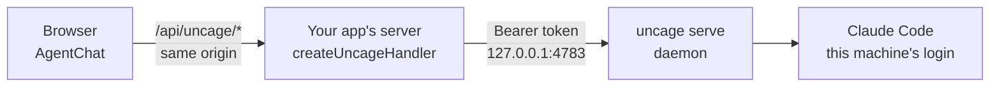

Local 模式适合和 agent 跑在**同一台机器**上的应用：开发者面板、内部工具、桌面类应用。Uncage 服务 `uncage serve`（英文叫 daemon）用这台机器的 Claude 登录运行 Claude Code；你的应用通过一个同源代理访问它，代理在服务器端加上服务的令牌。

如果你的用户各自有自己的电脑，请改用 [Connected 模式](/docs/zh-cn/start/quickstart-connected/)。

## 复制给你的 coding agent 的提示词

```text wrap
Add Uncage Local Mode to this Next.js (App Router) app, following https://uncage.vercel.app/docs/start/quickstart-local.md exactly.
1. npm i @uncage/server @uncage/react-ui @uncage/cli
2. Create app/api/uncage/[...path]/route.ts with createUncageHandler from @uncage/server/proxy (runtime 'nodejs', dynamic 'force-dynamic', export GET, POST, PATCH).
3. Create a page that renders <UncageProvider><AgentChat /></UncageProvider> from @uncage/react-ui inside a full-height container, and import '@uncage/react-ui/styles.css'.
Do not expose the daemon token to the browser and do not call the daemon from client code directly.
Verify: run "npx uncage doctor" and report each line; with "npx uncage serve --workspace <this repo>" running in another terminal and the app on http://localhost:3000, curl -s http://localhost:3000/api/uncage/runtimes returns a JSON array that contains "claude".
```

## 1. 前置条件

- macOS、Linux 或 Windows，以及 Node.js **22 或更高**（`node -v`）。`uncage serve` 在 CLI 能运行的地方都能运行；macOS 已在真机上验证，Linux 和 Windows 已通过 CI 验证，等待真机确认。
- 已安装并登录 Claude Code：`npm i -g @anthropic-ai/claude-code`，然后运行一次 `claude` 并输入 `/login`。
- 一个 Next.js（App Router）应用。从零开始：`npx create-next-app@latest my-app`（选 TypeScript、App Router）。

## 2. 安装

```sh
npm i @uncage/server @uncage/react-ui @uncage/cli
```

## 3. 添加两个文件

route handler 是一个同源代理。它在服务器端读取 Uncage 服务的令牌，令牌永远不会到达浏览器。

```ts title="app/api/uncage/[...path]/route.ts"
import { createUncageHandler } from '@uncage/server/proxy';

export const runtime = 'nodejs';
export const dynamic = 'force-dynamic';
export const { GET, POST, PATCH } = createUncageHandler();
```

```tsx title="app/page.tsx"
'use client';
import { AgentChat, UncageProvider } from '@uncage/react-ui';
import '@uncage/react-ui/styles.css';

export default function Page() {
  return (
    <div style={{ height: '100vh' }}>
      <UncageProvider>
        <AgentChat locale="en" />
      </UncageProvider>
    </div>
  );
}
```

`locale` 可以是 `'en'`（默认）或 `'zh-CN'`。

## 4. 启动 Uncage 服务

在单独的终端里保持运行：

```sh
npx uncage serve --workspace /absolute/path/to/the/project/the/agent/works/in
```

`--workspace` 是 agent 读写的目录。首次启动时，服务会创建 `~/.uncage/token`（权限 600）和 `~/.uncage/data`，然后打印：

```text
Uncage listening on http://127.0.0.1:4783 · workspace /…/project · runtimes: claude ✓, codex ✗ (not installed)
```

用 `npx uncage doctor` 检查一切。每一行是 ✓ 或 ✗，每个 ✗ 都会打印准确的 `fix:` 命令。Codex 显示“not installed” 没关系，它是可选的。

## 5. 运行你的应用

```sh
npm run dev
```

打开 `http://localhost:3000`，选择 **Claude Code**，然后问一句，比如“扫描这个仓库并运行测试”。

- 执行命令和修改文件会弹出审批卡片：**Allow once**（允许执行）/ **Deny**（拒绝）。设置 `locale="zh-CN"` 后，界面会显示中文。
- **Stop**（停止）会取消这次运行，并结束它的进程。
- 随时刷新：`<AgentChat>` 把打开的对话记在 `?session=<id>` 里，历史和待审批项都会回来。

## 整体结构



浏览器只和你的应用通信。你的应用在服务器端带着令牌转发到 `127.0.0.1:4783` 上的 Uncage 服务。服务在同一台机器上运行 Claude Code。它不是多租户云服务：不要把它暴露到公网，也不要让很多用户共用一个 Claude 登录。

## 其他框架

- **Fetch 风格的服务器**（Remix / React Router、SvelteKit、Hono、Bun）：`createUncageHandler()` 返回标准的 `(Request) => Promise<Response>` handler，挂在 `/api/uncage/*` 下（或传 `basePath`）。
- **Express、Connect、Fastify、`node:http`**：使用 `@uncage/server/proxy` 里的 `createUncageNodeHandler()`，挂在任何 body 解析器之前：

```ts title="server.ts (Express)"
import express from 'express';
import { createUncageNodeHandler } from '@uncage/server/proxy';

const app = express();
app.use('/api/uncage', createUncageNodeHandler()); // before express.json() and compression()
app.listen(3000);
```

- **前后端分离的 Vite 或 webpack SPA**：开发代理要保留浏览器的 `Host`（`changeOrigin: false`）。用 `changeOrigin: true` 时，所有 POST 都会得到 403 `forbidden_origin`，因为代理会拿 `Origin` 和被改写的 `Host` 比较。

[Local 模式详解](/docs/zh-cn/reference/local-mode/)介绍输入框的各项控制、附件、配置（`uncage.config.yaml`）和 Local 模式的安全模型。[CLI 参考](/docs/zh-cn/reference/cli/)列出了所有参数。

## 下一步

- [用 hooks 自定义界面](/docs/zh-cn/guides/custom-ui/)：用 `@uncage/react` 构建自己的对话界面。
- [故障排查](/docs/zh-cn/reference/troubleshooting/)：`forbidden_origin`、端口、登录。
