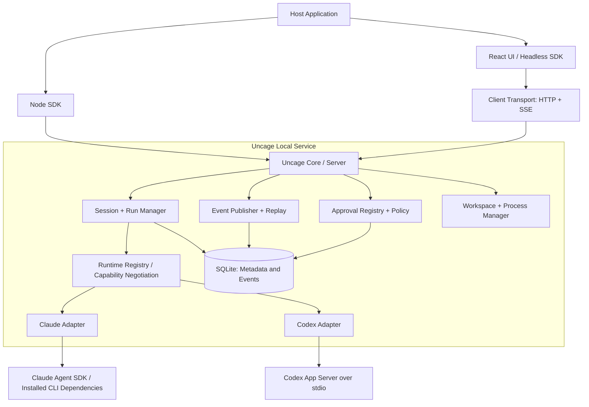
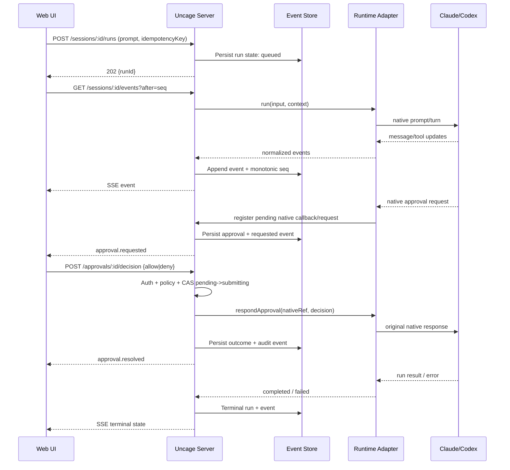

# Uncage — 技术架构设计（Architecture RFC）

> RFC-001 · V0.1 · 2026-11-06 · 状态：Proposed · 读者：Tech Lead / Runtime / Frontend / Security

## 1. 目标与约束

**目标：**在同一个 Host API 和 UI contract 下复用 Claude Agent SDK / Codex App Server 的实际执行能力，实现 session、run、events、tool approvals、可扩展 UI。

**约束：**不重写 agent loop；不把浏览器当 Runtime 容器；不要求运行时具有同等原生功能；V0 运行在受控本地 Node.js 进程；不作为高风险多租户共享执行环境。

## 2. 逻辑架构



**控制面 vs 执行面：**Client/Server 负责身份、状态、审批与事件；Runtime Adapter 负责创建/控制底层执行器；工具运行由各 Runtime 执行，必要时再叠加 OS/容器级隔离。

## 3. 关键技术决策（ADR）

| ADR | 决策 | 原因 | 代价/风险 |
|---|---|---|---|
| A-01 | TypeScript + Node.js 服务端 | 两套首选 SDK/CLI 接入容易；与 React 生态一致 | 需要 OS-specific 子进程管理 |
| A-02 | `RuntimeAdapter` 内部统一 API | 容纳不同 Runtime 的原生差异 | 容易过度抽象；必须限定最小公共集 |
| A-03 | V0 Codex 走 App Server stdio | 官方面向富客户端交互，支持双向审批 | JSON-RPC 事件与线程状态需要映射 |
| A-04 | Claude 走官方 Agent SDK | 使用原生 session/streaming/权限回调 | SDK API 与版本可能变化 |
| A-05 | 前端 HTTP commands + SSE events | 简化浏览器接入、重连与调试 | 需要事件持久化/replay，不是单一全双工通道 |
| A-06 | SQLite 保存公共会话/事件 | 本地部署简单，无需外部依赖 | 不做多主写入/远程规模化 |
| A-07 | Default UI + Headless React Hooks | 快速接入和自定义兼顾 | 状态必须在 SDK 单一来源维护 |
| A-08 | 本地 Token + loopback + Origin 校验 | 避免任意网页利用本机代理 | 本地进程被攻破后仍需 OS 边界 |
| A-09 | ACP/AG-UI 可复用但不强依赖 | 不被某标准覆盖范围限制 | 需维护映射和版本兼容 |

### 为什么不直接把 ACP 作为唯一内部协议？

ACP 面向 Agent ↔ Client 的协作，并不等价于 Uncage 的多 Runtime 生命周期、Local Daemon 安全、持久 Event Replay 或宿主 API。V0 以自己的最小 TypeScript contract 为内核，未来提供 ACP Adapter；前端事件可映射到 AG-UI。应避免创建与行业协议毫无必要的重复事件类型。

## 4. 领域模型

```text
Host (local service instance)
  └── Workspace (canonical absolute path + effective policy)
        └── Session (public sessionId, runtimeId, nativeSessionRef?)
              └── Run (runId, input, state, startedAt, endedAt)
                    ├── Event[] (monotonic seq per session)
                    ├── ToolInvocation[]
                    └── ApprovalRequest[]
```

- `sessionId` 是 Uncage 自己的公共 ID，不可直接等同于 Claude/Codex 原生 Session ID。
- `runtimeSessionRef` 是 Adapter 私有引用，按 Runtime/version 持久化并加访问控制；不可用时会话降级为只读历史或新 session。
- Session 与 Workspace 绑定且不可中途换根目录；需要切换则新建 Session。
- 每个 Session 在 V0 最多一个 active Run；`Run` 是一次输入到终态的执行生命周期。
- `Event` 至少一次投递、序列连续；客户端依赖 seq 去重，事件归一化后不应丢弃原始源类型用于诊断。

## 5. Runtime Adapter Contract

```ts
export interface RuntimeAdapter {
  readonly id: string;
  probe(): Promise<RuntimeProbe>;
  capabilities(): Promise<RuntimeCapabilities>;
  createSession(input: CreateNativeSession): Promise<NativeSession>;
  resumeSession?(nativeRef: string): Promise<NativeSession>;
  run(input: RunInput, ctx: RuntimeContext): AsyncIterable<RuntimeEvent>;
  cancel(nativeRef: string, runRef: string): Promise<void>;
  respondApproval(request: NativeApprovalRef, decision: NativeDecision): Promise<void>;
  closeSession(nativeRef: string): Promise<void>;
}

export type RuntimeCapabilities = {
  streaming: boolean;
  approval: { once: boolean; session: boolean; types: string[] };
  nativeResume: boolean;
  diffEvents: boolean;
  mcp: boolean;
  skills: 'supported' | 'partial' | 'unknown';
};
```

这是 Uncage **建议接口**，不是厂商原生 SDK 的原样类型。`respondApproval` 对 Callback Runtime 可通过 Pending Promise 进行桥接；对于 request-response Runtime 则回应原始 JSON-RPC Request ID。

**原则：**强制适配公共生命周期，能力不可用时返回明确 unsupported；Runtime-specific advanced features 通过 namespaced `extensions` 暴露，不要塞进基础字段。

## 6. 单次执行时序



**注意：**“approval.resolved”只表示授权被接收/拒绝；命令的完成结果必须由后续 Tool/Run 状态表达。

## 7. 审批机制与一致性

审批实体：`id, sessionId, runId, runtimeId, nativeRequestRef, type, target, allowedScopes, status, createdAt, expiresAt, decision, version`。

状态机：`pending -> submitting -> approved|denied|failed`；`pending -> expired|cancelled`；网络超时进入 `unknown/reconciling` 而非默认重试有副作用的 Runtime 回调。

- `POST /approvals/:id/decision` 需要身份校验 + Session 授权 + TTL + CAS。
- **同一个 idempotency key 相同决策可返回既有结果，不同决策返回 409**。
- 由 Server 维护 in-memory native callback handle + 持久 metadata；重启后无法恢复的 callback 应显式标记 `interrupted/expired`，不假装可点击。
- 超时/页面关闭的清理逻辑必须使 Runtime 返回安全拒绝或中断；不能悬挂 Promise 无限等待。
- 不允许前端直接选择 Runtime 原生 `bypassPermissions`；高级 scope 由 Service 配置+Capability 决定。

### Claude Adapter

利用 Claude Agent SDK 的 `canUseTool` callback 捕获需要审批的请求，转换为统一 ApprovalRequest；UI 决策再映射为原生 allow/deny 响应。注意原生 permission mode、allow/deny rules 与 hooks 的求值顺序，回调不一定拦截所有调用；要实现强制外部策略，需要在 Runtime 之前配合可信的 OS sandbox/命令策略，而不是只依赖 UI callback。参见官方权限文档。

### Codex Adapter

通过 App Server 的 `stdio` JSON-RPC 维护本地进程，处理 `thread/*`、`turn/*`、`item/*` 事件，并对 server-initiated approval request 以相同 request ID 回复。命令、文件变化、网络/权限请求各自支持的决策不同，需按 capabilities 和 `availableDecisions` 映射；不可把所有请求都视作 shell execute。App Server WebSocket 传输当前可能有实验性限制，V0 不依赖。

## 8. 事件流、重连与投递语义

统一 envelope：

```json
{
  "eventId": "evt_0000123",
  "sequence": 123,
  "sessionId": "ses_01",
  "runId": "run_01",
  "type": "approval.requested",
  "occurredAt": "2026-11-06T10:00:00Z",
  "schemaVersion": "1.0",
  "payload": {"approvalId":"apr_01","type":"shell.execute"}
}
```

- append → commit DB → publish SSE，保证断线后 replay；重放来自本地 DB。
- `Last-Event-ID` 或 `after` 参数恢复；若 seq 已被清理，返回 `replay_unavailable` 并使用 Session snapshot。
- 前端 reducer 按 `(sessionId, sequence)` 去重、按 toolId/updateId 合并碎片；不假设网络恰好一次。
- 审批、工具、消息彼此独立，消息 delta 可合并显示，但原始事件按配置限量持久化。

## 9. 本地安全模型（必须）

**威胁：**恶意网页访问 localhost、恶意 prompt 指令、危险 Shell、符号链接逃逸、终端共享凭据、Agent 执行任意代码、日志泄漏、并发 Session 错授权。

**控制：**
1. 默认仅绑定 `127.0.0.1`；不开放局域网监听。绑定 loopback 仍有恶意本机网页风险。
2. 本地 server 生成高熵 token；所有操作 API 鉴权，严格校验 Origin/Host，禁用通配 CORS；需要考虑 DNS rebinding/CSRF。
3. Workspace 使用 canonical realpath + symlink checks；但**路径检查不是安全沙箱**，执行权限需由 OS Sandbox/容器策略强制约束。
4. 尽量使用 Runtime 原生 sandbox + 命令审批；默认不提供 bypassPermission 快捷开关。
5. 运行进程继承最小环境变量；不把其他租户/API 凭据暴露给子进程；日志脱敏。
6. 进程树取消：停止任务时清理子进程、标记未决审批，超时强制终止。
7. 明确声明：V0 本地单用户执行不具备不可信多租户安全隔离保证。

## 10. 存储和故障处理

建议 SQLite 表：`workspaces`, `sessions`, `runs`, `events`, `approvals`, `runtime_refs`, `audit_logs`；所有表使用稳定 ID，事件表按 `(session_id, sequence)` 唯一索引，审批状态使用 `version` CAS。

| 故障 | 处理 |
|---|---|
| 前端断开 | Runtime 继续/暂停依据服务端策略；事件持久化；重连 replay |
| Runtime 崩溃 | Run 标记 interrupted，未决审批取消，记录 stderr 摘要（脱敏） |
| Server 重启 | 加载历史；检查 native resume 支持；不可恢复的 running 标 interrupted |
| 事件写库失败 | 不发送虚假已提交事件；将 Run 标记基础设施错误/安全停机 |
| 审批 ack 不确定 | reconciliation，禁止无条件重发有副作用操作 |
| Adapter 版本不兼容 | probe 失败且给出版本/修复建议，不能继续静默启动 |

## 11. 测试策略

- **Contract tests：**每个 Adapter 在相同 fixture 下输出规范事件和准确的 capabilities。
- **Integration：**两个真实 Runtime 的 happy path、tool run、approval allow/deny、cancel、resume（能力支持时）。
- **Fault injection：**乱序/重复事件、SSE 断线、JSON-RPC 响应丢失、审批超时、Runtime 崩溃、Server 重启。
- **Security：**跨 Origin 请求、无 token 请求、symbolic link workspace escape、敏感日志与命令注入情形。
- **UI E2E：**默认 UI 与 headless UI 完整测试。

真实 Runtime E2E 有外部账号/费用依赖，CI 分为每 PR 的 Mock Contract 与受控环境的定期 live integration。

## 12. 技术选型清单

| 领域 | 首选 | 备选/备注 |
|---|---|---|
| Monorepo | pnpm workspaces + Turborepo | npm workspaces 也可 |
| Service | Node.js + Fastify | Hono (Node adapter) |
| Transport | HTTP REST + SSE | WebSocket 为后续可选 |
| Schemas | Zod + OpenAPI | ts-rest 等可考虑 |
| Persistence | SQLite + Drizzle ORM | 轻量 SQL driver |
| React | Headless hooks + composable components | 状态 store 独立于 React |
| Unit/contract | Vitest | — |
| UI E2E | Playwright | — |
| Structured logs | Pino | 配套 redaction |
| Packaging | tsup / unbuild | 需要 ESM/CJS 决策 |

以上为建议选型，研发 kickoff 时确定并提交 ADR；不要被具体工具锁死。

## 13. 参考与待验证项

- Claude SDK permissions: https://code.claude.com/docs/en/agent-sdk/permissions
- Codex App Server: https://developers.openai.com/codex/app-server
- Codex App Server source: https://github.com/openai/codex/tree/main/codex-rs/app-server
- ACP: https://agentclientprotocol.com/
- AG-UI: https://github.com/ag-ui-protocol/ag-ui

注意：底层 SDK 版本变化较快。每次 release 固定经过验证的 Runtime/SDK 版本组合，不依据文档当前网页假设任何旧版本都有相同行为。
